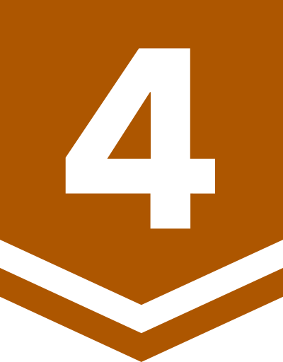

<!-- Generated by update_README.py. Edit problems.json for titles and levels. -->

# BOJ 08000–08999

[전체 구간](../README.md)

| No. | Title | Difficulty | Solution |
| --- | --- | --- | --- |
| [08012](https://www.acmicpc.net/problem/8012) | 한동이는 영업사원! |  | [C++](./08012/08012.cpp) |
| [08063](https://www.acmicpc.net/problem/8063) | Three-Coloring of Binary Trees |  | [C++](./08063/08063.cpp) |
| [08111](https://www.acmicpc.net/problem/8111) | 0과 1 |  | [C++](./08111/08111.cpp) |
| [08118](https://www.acmicpc.net/problem/8118) | Board Covering |  | [C++](./08118/08118.cpp) |
| [08217](https://www.acmicpc.net/problem/8217) | 유성 |  | [C++](./08217/08217.cpp) |
| [08246](https://www.acmicpc.net/problem/8246) | Stół |  | [Java](./08246/08246.java) |
| [08270](https://www.acmicpc.net/problem/8270) | Tulips |  | [Java](./08270/08270.java) |
| [08295](https://www.acmicpc.net/problem/8295) | Rectangles |  | [Java](./08295/08295.java) |
| [08314](https://www.acmicpc.net/problem/8314) | Acyclic Decomposition |  | [C++](./08314/08314.cpp) |
| [08320](https://www.acmicpc.net/problem/8320) | 직사각형을 만드는 방법 |  | [Java](./08320/08320.java) |
| [08370](https://www.acmicpc.net/problem/8370) | Plane |  | [C](./08370/08370.c) |
| [08371](https://www.acmicpc.net/problem/8371) | Dyslexia |  | [Java](./08371/08371.java) |
| [08387](https://www.acmicpc.net/problem/8387) | Dyslexia |  | [Java](./08387/08387.java) |
| [08393](https://www.acmicpc.net/problem/8393) | 합 |  | [C](./08393/08393.c) |
| [08394](https://www.acmicpc.net/problem/8394) | 악수 |  | [Java](./08394/08394.java) |
| [08436](https://www.acmicpc.net/problem/8436) | Kamil |  | [C++](./08436/08436.cpp) |
| [08437](https://www.acmicpc.net/problem/8437) | Julka |  | [Java](./08437/08437.java) |
| [08462](https://www.acmicpc.net/problem/8462) | 배열의 힘 |  | [C++](./08462/08462.cpp) |
| [08537](https://www.acmicpc.net/problem/8537) | Imiona mrówek |  | [Java](./08537/08537.java) |
| [08538](https://www.acmicpc.net/problem/8538) | Bałagan i Stonki |  | [Java](./08538/08538.java) |
| [08545](https://www.acmicpc.net/problem/8545) | Zadanie próbne |  | [Java](./08545/08545.java) |
| [08549](https://www.acmicpc.net/problem/8549) | Autostrady |  | [Java](./08549/08549.java) |
| [08551](https://www.acmicpc.net/problem/8551) | Blokada |  | [C++](./08551/08551.cpp) |
| [08558](https://www.acmicpc.net/problem/8558) | Silnia |  | [Java](./08558/08558.java) |
| [08559](https://www.acmicpc.net/problem/8559) | Potęga |  | [Java](./08559/08559.java) |
| [08568](https://www.acmicpc.net/problem/8568) | Skoczki |  | [C++](./08568/08568.cpp) |
| [08571](https://www.acmicpc.net/problem/8571) | Apteka |  | [C++](./08571/08571.cpp) |
| [08574](https://www.acmicpc.net/problem/8574) | Ratownik |  | [Java](./08574/08574.java) |
| [08595](https://www.acmicpc.net/problem/8595) | 히든 넘버 |  | [Java](./08595/08595.java) |
| [08610](https://www.acmicpc.net/problem/8610) | Szyfr |  | [C++](./08610/08610.cpp) |
| [08611](https://www.acmicpc.net/problem/8611) | 팰린드롬 숫자 |  | [Java](./08611/08611.java) |
| [08620](https://www.acmicpc.net/problem/8620) | Hurtownia |  | [Java](./08620/08620.java) |
| [08635](https://www.acmicpc.net/problem/8635) | Zliczacz liter |  | [Java](./08635/08635.java) |
| [08638](https://www.acmicpc.net/problem/8638) | Zwycięzcy |  | [Java](./08638/08638.java) |
| [08658](https://www.acmicpc.net/problem/8658) | Liczba |  | [Java](./08658/08658.java) |
| [08661](https://www.acmicpc.net/problem/8661) | Stopki |  | [Java](./08661/08661.java) |
| [08663](https://www.acmicpc.net/problem/8663) | Konik polny |  | [Java](./08663/08663.java) |
| [08668](https://www.acmicpc.net/problem/8668) | Konik polny 2 |  | [Java](./08668/08668.java) |
| [08669](https://www.acmicpc.net/problem/8669) | Las |  | [Java](./08669/08669.java) |
| [08671](https://www.acmicpc.net/problem/8671) | Długa taśma |  | [Java](./08671/08671.java) |
| [08674](https://www.acmicpc.net/problem/8674) | Tabliczka |  | [Java](./08674/08674.java) |
| [08676](https://www.acmicpc.net/problem/8676) | Figury |  | [Java](./08676/08676.java) |
| [08678](https://www.acmicpc.net/problem/8678) | Zbiór |  | [Java](./08678/08678.java) |
| [08710](https://www.acmicpc.net/problem/8710) | Koszykarz |  | [Java](./08710/08710.java) |
| [08712](https://www.acmicpc.net/problem/8712) | Wężyk |  | [Java](./08712/08712.java) |
| [08713](https://www.acmicpc.net/problem/8713) | Znak działania |  | [Java](./08713/08713.java) |
| [08714](https://www.acmicpc.net/problem/8714) | Monety |  | [Java](./08714/08714.java) |
| [08715](https://www.acmicpc.net/problem/8715) | Permutacja |  | [Java](./08715/08715.java) |
| [08716](https://www.acmicpc.net/problem/8716) | Pole |  | [Java](./08716/08716.java) |
| [08717](https://www.acmicpc.net/problem/8717) | Taśma |  | [Java](./08717/08717.java) |
| [08718](https://www.acmicpc.net/problem/8718) | Bałwanek |  | [Java](./08718/08718.java) |
| [08719](https://www.acmicpc.net/problem/8719) | Piłeczka |  | [Java](./08719/08719.java) |
| [08721](https://www.acmicpc.net/problem/8721) | Wykreślanka |  | [Java](./08721/08721.java) |
| [08723](https://www.acmicpc.net/problem/8723) | Patyki |  | [Java](./08723/08723.java) |
| [08724](https://www.acmicpc.net/problem/8724) | Pinezki |  | [Java](./08724/08724.java) |
| [08725](https://www.acmicpc.net/problem/8725) | Szachy |  | [Java](./08725/08725.java) |
| [08728](https://www.acmicpc.net/problem/8728) | Grusze i jabłonie |  | [Java](./08728/08728.java) |
| [08731](https://www.acmicpc.net/problem/8731) | Sznurki |  | [C++](./08731/08731.cpp) |
| [08741](https://www.acmicpc.net/problem/8741) | 이진수 합 |  | [Java](./08741/08741.java) |
| [08760](https://www.acmicpc.net/problem/8760) | Schronisko |  | [C](./08760/08760.c) |
| [08772](https://www.acmicpc.net/problem/8772) | Szyfr Cezara |  | [Java](./08772/08772.java) |
| [08789](https://www.acmicpc.net/problem/8789) | Poezja z gwiazdką |  | [C++](./08789/08789.cpp) |
| [08794](https://www.acmicpc.net/problem/8794) | Poniedziałki |  | [Java](./08794/08794.java) |
| [08806](https://www.acmicpc.net/problem/8806) | Papier kamień nożyczki |  | [Java](./08806/08806.java) |
| [08815](https://www.acmicpc.net/problem/8815) | Test |  | [Java](./08815/08815.java) |
| [08818](https://www.acmicpc.net/problem/8818) | Deski |  | [Java](./08818/08818.java) |
| [08826](https://www.acmicpc.net/problem/8826) | Spacer |  | [Java](./08826/08826.java) |
| [08846](https://www.acmicpc.net/problem/8846) | Wymiana żarówki |  | [Java](./08846/08846.java) |
| [08871](https://www.acmicpc.net/problem/8871) | Zadanie próbne 2 |  | [C](./08871/08871.c) |
| [08891](https://www.acmicpc.net/problem/8891) | 점 숫자 |  | [C++](./08891/08891.cpp) |
| [08892](https://www.acmicpc.net/problem/8892) | 팰린드롬 |  | [Java](./08892/08892.java) |
| [08898](https://www.acmicpc.net/problem/8898) | 스포츠 전문 채널 GSK |  | [C++](./08898/08898.cpp) |
| [08911](https://www.acmicpc.net/problem/8911) | 거북이 |  | [C++](./08911/08911.cpp) |
| [08912](https://www.acmicpc.net/problem/8912) | Sales |  | [Java](./08912/08912.java) |
| [08932](https://www.acmicpc.net/problem/8932) | 7종 경기 |  | [Java](./08932/08932.java) |
| [08949](https://www.acmicpc.net/problem/8949) | 대충 더해 |  | [Java](./08949/08949.java) |
| [08958](https://www.acmicpc.net/problem/8958) | OX퀴즈 |  | [C](./08958/08958.c) |
| [08965](https://www.acmicpc.net/problem/8965) | Circular Sequence |  | [Java](./08965/08965.java) |
| [08973](https://www.acmicpc.net/problem/8973) | 수학 공책 |  | [C++](./08973/08973.cpp) |
| [08974](https://www.acmicpc.net/problem/8974) | 희주의 수학시험 |  | [Java](./08974/08974.java) |
| [08979](https://www.acmicpc.net/problem/8979) | 올림픽 |  | [Java](./08979/08979.java) |
| [08986](https://www.acmicpc.net/problem/8986) | 전봇대 |  | [C++](./08986/08986.cpp) |
