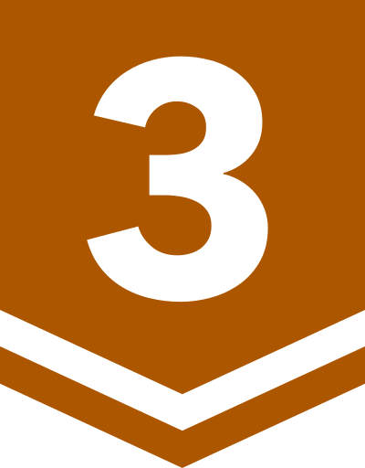

<!-- Generated by update_README.py. Edit problems.json for titles and levels. -->

# BOJ 12000–12999

[전체 구간](../README.md)

| No. | Title | Difficulty | Solution |
| --- | --- | --- | --- |
| [12010](https://www.acmicpc.net/problem/12010) | Landscaping |  | [C++](./12010/12010.cpp) |
| [12015](https://www.acmicpc.net/problem/12015) | 가장 긴 증가하는 부분 수열 2 |  | [C++](./12015/12015.cpp) |
| [12018](https://www.acmicpc.net/problem/12018) | Yonsei TOTO |  | [C++](./12018/12018.cpp) |
| [12026](https://www.acmicpc.net/problem/12026) | BOJ 거리 |  | [C++](./12026/12026.cpp) |
| [12033](https://www.acmicpc.net/problem/12033) | 김인천씨의 식료품가게 (Small) |  | [C++](./12033/12033.cpp) |
| [12034](https://www.acmicpc.net/problem/12034) | 김인천씨의 식료품가게 (Large) |  | [C++](./12034/12034.cpp) |
| [12044](https://www.acmicpc.net/problem/12044) | Robot Rock Band (Small) |  | [Java](./12044/12044.java) |
| [12048](https://www.acmicpc.net/problem/12048) | Sums of Sums (Small) |  | [C++](./12048/12048.cpp) |
| [12050](https://www.acmicpc.net/problem/12050) | Dynamic Grid (Small) |  | [Java](./12050/12050.java) |
| [12051](https://www.acmicpc.net/problem/12051) | Dynamic Grid (Large) |  | [Java](./12051/12051.java) |
| [12074](https://www.acmicpc.net/problem/12074) | Googol String (Small) |  | [Java](./12074/12074.java) |
| [12090](https://www.acmicpc.net/problem/12090) | 초성 변환 |  | [Java](./12090/12090.java) |
| [12092](https://www.acmicpc.net/problem/12092) | 포켓몬 GO 진화 | — | [C++](./12092/12092.cpp) |
| [12096](https://www.acmicpc.net/problem/12096) | 12096번 | — | [Text](./12096/12096.txt) |
| [12100](https://www.acmicpc.net/problem/12100) | 2048 (Easy) |  | [C++](./12100/12100.cpp) |
| [12101](https://www.acmicpc.net/problem/12101) | 1, 2, 3 더하기 2 |  | [C++](./12101/12101.cpp) |
| [12107](https://www.acmicpc.net/problem/12107) | 약수 지우기 게임 1 |  | [C++](./12107/12107.cpp) |
| [12166](https://www.acmicpc.net/problem/12166) | Standing Ovation (Small) |  | [Java](./12166/12166.java) |
| [12167](https://www.acmicpc.net/problem/12167) | Standing Ovation (Large) |  | [Java](./12167/12167.java) |
| [12174](https://www.acmicpc.net/problem/12174) | #include &lt;Google I/O.h&gt; |  | [Java](./12174/12174.java) |
| [12178](https://www.acmicpc.net/problem/12178) | Power Levels (Small) |  | [C++](./12178/12178.cpp) |
| [12184](https://www.acmicpc.net/problem/12184) | GBus count (Small) |  | [Java](./12184/12184.java) |
| [12185](https://www.acmicpc.net/problem/12185) | GBus count (Large) |  | [Java](./12185/12185.java) |
| [12250](https://www.acmicpc.net/problem/12250) | New Lottery Game (Small) |  | [Java](./12250/12250.java) |
| [12285](https://www.acmicpc.net/problem/12285) | Spaceship Defence (Large) |  | [C++](./12285/12285.cpp) |
| [12313](https://www.acmicpc.net/problem/12313) | Erdős–Szekeres (Small) |  | [C++](./12313/12313.cpp) |
| [12348](https://www.acmicpc.net/problem/12348) | 분해합 2 |  | [Java](./12348/12348.java) |
| [12351](https://www.acmicpc.net/problem/12351) | Hedgemony (Small) |  | [Java](./12351/12351.java) |
| [12352](https://www.acmicpc.net/problem/12352) | Hedgemony (Large) |  | [Java](./12352/12352.java) |
| [12353](https://www.acmicpc.net/problem/12353) | Dr. Spaceman의 특별한 알고리즘 |  | [Java](./12353/12353.java) |
| [12400](https://www.acmicpc.net/problem/12400) | Speaking in Tongues (Small) |  | [Java](./12400/12400.java) |
| [12423](https://www.acmicpc.net/problem/12423) | 전장 (Small) |  | [C++](./12423/12423.cpp) |
| [12424](https://www.acmicpc.net/problem/12424) | 전장 (Large) |  | [C++](./12424/12424.cpp) |
| [12427](https://www.acmicpc.net/problem/12427) | 박테리아 (Small) |  | [C++](./12427/12427.cpp) |
| [12428](https://www.acmicpc.net/problem/12428) | 박테리아 (Large) |  | [C++](./12428/12428.cpp) |
| [12435](https://www.acmicpc.net/problem/12435) | 한강 (Small) |  | [C++](./12435/12435.cpp) |
| [12437](https://www.acmicpc.net/problem/12437) | 새로운 달력 (Small) |  | [C++](./12437/12437.cpp) |
| [12438](https://www.acmicpc.net/problem/12438) | 새로운 달력 (Large) |  | [C++](./12438/12438.cpp) |
| [12455](https://www.acmicpc.net/problem/12455) | 最高のコーヒー (Small) |  | [C++](./12455/12455.cpp) |
| [12456](https://www.acmicpc.net/problem/12456) | 모닝커피 (Large) |  | [C++](./12456/12456.cpp) |
| [12503](https://www.acmicpc.net/problem/12503) | FreeCell Statistics (Small) |  | [C++](./12503/12503.cpp) |
| [12517](https://www.acmicpc.net/problem/12517) | Centauri Prime (Small1) |  | [Java](./12517/12517.java) |
| [12518](https://www.acmicpc.net/problem/12518) | Centauri Prime (Small2) |  | [Java](./12518/12518.java) |
| [12523](https://www.acmicpc.net/problem/12523) | Twibet (Small) |  | [Java](./12523/12523.java) |
| [12524](https://www.acmicpc.net/problem/12524) | Twibet (Large) |  | [Java](./12524/12524.java) |
| [12571](https://www.acmicpc.net/problem/12571) | Rope Intranet (Small) |  | [Java](./12571/12571.java) |
| [12572](https://www.acmicpc.net/problem/12572) | Rope Intranet (Large) |  | [Java](./12572/12572.java) |
| [12593](https://www.acmicpc.net/problem/12593) | Theme Park (Small) |  | [C++](./12593/12593.cpp) |
| [12595](https://www.acmicpc.net/problem/12595) | Odd Man Out (Small) |  | [Java](./12595/12595.java) |
| [12596](https://www.acmicpc.net/problem/12596) | Odd Man Out (Large) |  | [Java](./12596/12596.java) |
| [12603](https://www.acmicpc.net/problem/12603) | Store Credit (Small) |  | [Java](./12603/12603.java) |
| [12604](https://www.acmicpc.net/problem/12604) | Store Credit (Large) |  | [Java](./12604/12604.java) |
| [12605](https://www.acmicpc.net/problem/12605) | 단어순서 뒤집기 |  | [Java](./12605/12605.java) |
| [12606](https://www.acmicpc.net/problem/12606) | Reverse Words (Large) |  | [Java](./12606/12606.java) |
| [12607](https://www.acmicpc.net/problem/12607) | T9 Spelling (Small) |  | [Java](./12607/12607.java) |
| [12608](https://www.acmicpc.net/problem/12608) | T9 Spelling (Large) |  | [Java](./12608/12608.java) |
| [12634](https://www.acmicpc.net/problem/12634) | Stock Charts (Large) |  | [C++](./12634/12634.cpp) |
| [12657](https://www.acmicpc.net/problem/12657) | Watersheds (Small) |  | [C++](./12657/12657.cpp) |
| [12727](https://www.acmicpc.net/problem/12727) | Numbers (Small) |  | [C++](./12727/12727.cpp) |
| [12738](https://www.acmicpc.net/problem/12738) | 가장 긴 증가하는 부분 수열 3 |  | [C++](./12738/12738.cpp) |
| [12742](https://www.acmicpc.net/problem/12742) | 혼합물 (Small) |  | [C++](./12742/12742.cpp) |
| [12743](https://www.acmicpc.net/problem/12743) | 혼합물 (Large) |  | [C++](./12743/12743.cpp) |
| [12746](https://www.acmicpc.net/problem/12746) | Traffic (Large) |  | [C++](./12746/12746.cpp) |
| [12755](https://www.acmicpc.net/problem/12755) | 수면 장애 |  | [C++](./12755/12755.cpp) |
| [12756](https://www.acmicpc.net/problem/12756) | 고급 여관 |  | [Java](./12756/12756.java) |
| [12759](https://www.acmicpc.net/problem/12759) | 틱! 택! 토! |  | [Java](./12759/12759.java) |
| [12760](https://www.acmicpc.net/problem/12760) | 최후의 승자는 누구? |  | [Python](./12760/12760.py) |
| [12761](https://www.acmicpc.net/problem/12761) | 돌다리 |  | [C++](./12761/12761.cpp) |
| [12776](https://www.acmicpc.net/problem/12776) | Swap Space |  | [C++](./12776/12776.cpp) |
| [12778](https://www.acmicpc.net/problem/12778) | CTP공국으로 이민 가자 |  | [Java](./12778/12778.java) |
| [12779](https://www.acmicpc.net/problem/12779) | 상품 is 뭔들 |  | [C++](./12779/12779.cpp) |
| [12780](https://www.acmicpc.net/problem/12780) | 원피스 |  | [Java](./12780/12780.java) |
| [12782](https://www.acmicpc.net/problem/12782) | 비트 우정지수 |  | [C++](./12782/12782.cpp) |
| [12784](https://www.acmicpc.net/problem/12784) | 인하니카 공화국 |  | [C++](./12784/12784.cpp) |
| [12785](https://www.acmicpc.net/problem/12785) | 토쟁이의 등굣길 |  | [C++](./12785/12785.cpp) |
| [12787](https://www.acmicpc.net/problem/12787) | 지금 밥이 문제냐 |  | [C++](./12787/12787.cpp) |
| [12788](https://www.acmicpc.net/problem/12788) | 제 2회 IUPC는 잘 개최될 수 있을까? |  | [C++](./12788/12788.cpp) |
| [12789](https://www.acmicpc.net/problem/12789) | 도키도키 간식드리미 |  | [Java](./12789/12789.java) |
| [12790](https://www.acmicpc.net/problem/12790) | Mini Fantasy War |  | [Java](./12790/12790.java) |
| [12791](https://www.acmicpc.net/problem/12791) | Starman |  | [Java](./12791/12791.java) |
| [12795](https://www.acmicpc.net/problem/12795) | 반평면 땅따먹기 |  | [C++](./12795/12795.cpp) |
| [12796](https://www.acmicpc.net/problem/12796) | 나의 행렬곱셈 답사기 |  | [C++](./12796/12796.cpp) |
| [12813](https://www.acmicpc.net/problem/12813) | 이진수 연산 |  | [Java](./12813/12813.java) |
| [12832](https://www.acmicpc.net/problem/12832) | Tickets |  | [C++](./12832/12832.cpp) |
| [12833](https://www.acmicpc.net/problem/12833) | XORXORXOR |  | [Java](./12833/12833.java) |
| [12834](https://www.acmicpc.net/problem/12834) | 주간 미팅 |  | [C++](./12834/12834.cpp) |
| [12836](https://www.acmicpc.net/problem/12836) | 가계부 (Easy) |  | [Java](./12836/12836.java) |
| [12837](https://www.acmicpc.net/problem/12837) | 가계부 (Hard) |  | [C++](./12837/12837.cpp) |
| [12840](https://www.acmicpc.net/problem/12840) | 창용이의 시계 |  | [Java](./12840/12840.java) |
| [12843](https://www.acmicpc.net/problem/12843) | 복수전공 |  | [C++](./12843/12843.cpp) |
| [12844](https://www.acmicpc.net/problem/12844) | XOR |  | [C++](./12844/12844.cpp) |
| [12845](https://www.acmicpc.net/problem/12845) | 모두의 마블 |  | [C++](./12845/12845.cpp) |
| [12846](https://www.acmicpc.net/problem/12846) | 무서운 아르바이트 |  | [C++](./12846/12846.cpp) |
| [12847](https://www.acmicpc.net/problem/12847) | 꿀 아르바이트 |  | [C++](./12847/12847.cpp) |
| [12849](https://www.acmicpc.net/problem/12849) | 본대 산책 |  | [C++](./12849/12849.cpp) |
| [12850](https://www.acmicpc.net/problem/12850) | 본대 산책2 |  | [C++](./12850/12850.cpp) |
| [12851](https://www.acmicpc.net/problem/12851) | 숨바꼭질 2 |  | [C++](./12851/12851.cpp) |
| [12852](https://www.acmicpc.net/problem/12852) | 1로 만들기 2 |  | [Java](./12852/12852.java) |
| [12865](https://www.acmicpc.net/problem/12865) | 평범한 배낭 |  | [C++](./12865/12865.cpp) |
| [12866](https://www.acmicpc.net/problem/12866) | 피노키오 |  | [Java](./12866/12866.java) |
| [12871](https://www.acmicpc.net/problem/12871) | 무한 문자열 |  | [Java](./12871/12871.java) |
| [12873](https://www.acmicpc.net/problem/12873) | 기념품 |  | [Java](./12873/12873.java) |
| [12875](https://www.acmicpc.net/problem/12875) | 칙령 |  | [C++](./12875/12875.cpp) |
| [12887](https://www.acmicpc.net/problem/12887) | 경로 게임 |  | [C++](./12887/12887.cpp) |
| [12891](https://www.acmicpc.net/problem/12891) | DNA 비밀번호 |  | [C++](./12891/12891.cpp) |
| [12893](https://www.acmicpc.net/problem/12893) | 적의 적 |  | [C++](./12893/12893.cpp) |
| [12897](https://www.acmicpc.net/problem/12897) | Candy |  | [C++](./12897/12897.cpp) |
| [12899](https://www.acmicpc.net/problem/12899) | 데이터 구조 |  | [C++](./12899/12899.cpp) |
| [12904](https://www.acmicpc.net/problem/12904) | A와 B |  | [Java](./12904/12904.java) |
| [12916](https://www.acmicpc.net/problem/12916) | K-Path |  | [C++](./12916/12916.cpp) |
| [12919](https://www.acmicpc.net/problem/12919) | A와 B 2 |  | [C++](./12919/12919.cpp) |
| [12920](https://www.acmicpc.net/problem/12920) | 평범한 배낭 2 |  | [C++](./12920/12920.cpp) |
| [12921](https://www.acmicpc.net/problem/12921) | 제한된 메모리 |  | [C++](./12921/12921.cpp) |
| [12924](https://www.acmicpc.net/problem/12924) | 멋진 쌍 |  | [C++](./12924/12924.cpp) |
| [12927](https://www.acmicpc.net/problem/12927) | 배수 스위치 |  | [C++](./12927/12927.cpp) |
| [12931](https://www.acmicpc.net/problem/12931) | 두 배 더하기 |  | [C++](./12931/12931.cpp) |
| [12933](https://www.acmicpc.net/problem/12933) | 오리 |  | [C++](./12933/12933.cpp) |
| [12934](https://www.acmicpc.net/problem/12934) | 턴 게임 |  | [C++](./12934/12934.cpp) |
| [12944](https://www.acmicpc.net/problem/12944) | 재미있는 숫자 놀이 |  | [C++](./12944/12944.cpp) |
| [12947](https://www.acmicpc.net/problem/12947) | 트리 만들기 |  | [C++](./12947/12947.cpp) |
| [12956](https://www.acmicpc.net/problem/12956) | 퍼레이드 |  | [C++](./12956/12956.cpp) |
| [12963](https://www.acmicpc.net/problem/12963) | 달리기 |  | [C++](./12963/12963.cpp) |
| [12966](https://www.acmicpc.net/problem/12966) | 턴 게임 2 |  | [C++](./12966/12966.cpp) |
| [12970](https://www.acmicpc.net/problem/12970) | AB |  | [C++](./12970/12970.cpp) |
| [12986](https://www.acmicpc.net/problem/12986) | 화려한 마을2 |  | [C++](./12986/12986.cpp) |
| [12988](https://www.acmicpc.net/problem/12988) | 주식 차트 |  | [C++](./12988/12988.cpp) |
| [12990](https://www.acmicpc.net/problem/12990) | A Heap of Heaps |  | [C++](./12990/12990.cpp) |
| [12999](https://www.acmicpc.net/problem/12999) | 화려한 마을3 |  | [C++](./12999/12999.cpp) |
