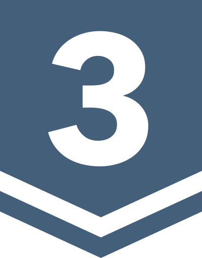

<!-- Generated by update_README.py. Edit problems.json for titles and levels. -->

# BOJ 16000–16999

[전체 구간](../README.md)

| No. | Title | Difficulty | Solution |
| --- | --- | --- | --- |
| [16017](https://www.acmicpc.net/problem/16017) | Telemarketer or not? |  | [Java](./16017/16017.java) |
| [16018](https://www.acmicpc.net/problem/16018) | Occupy parking |  | [Java](./16018/16018.java) |
| [16019](https://www.acmicpc.net/problem/16019) | Are we there yet? |  | [Java](./16019/16019.java) |
| [16020](https://www.acmicpc.net/problem/16020) | Sunflowers |  | [Java](./16020/16020.java) |
| [16032](https://www.acmicpc.net/problem/16032) | Income Inequality |  | [Java](./16032/16032.java) |
| [16074](https://www.acmicpc.net/problem/16074) | Mountaineers |  | [C++](./16074/16074.cpp) |
| [16076](https://www.acmicpc.net/problem/16076) | 휴식이 필요해 | — | [Text](./16076/16076.txt) |
| [16088](https://www.acmicpc.net/problem/16088) | Finding Your Coach |  | [Java](./16088/16088.java) |
| [16099](https://www.acmicpc.net/problem/16099) | Larger Sport Facility |  | [Java](./16099/16099.java) |
| [16103](https://www.acmicpc.net/problem/16103) | Drawn and Quartered |  | [Java](./16103/16103.java) |
| [16112](https://www.acmicpc.net/problem/16112) | 5차 전직 |  | [Java](./16112/16112.java) |
| [16113](https://www.acmicpc.net/problem/16113) | 시그널 |  | [C++](./16113/16113.cpp) |
| [16114](https://www.acmicpc.net/problem/16114) | 화살표 연산자 |  | [C++](./16114/16114.cpp) |
| [16117](https://www.acmicpc.net/problem/16117) | 실버런 |  | [C++](./16117/16117.cpp) |
| [16120](https://www.acmicpc.net/problem/16120) | PPAP |  | [C++](./16120/16120.cpp) |
| [16126](https://www.acmicpc.net/problem/16126) | 동아리방 확장 |  | [C++](./16126/16126.cpp) |
| [16130](https://www.acmicpc.net/problem/16130) | 벌점 (DemeritPoints) |  | [C++](./16130/16130.cpp) |
| [16134](https://www.acmicpc.net/problem/16134) | 조합 (Combination) |  | [C++](./16134/16134.cpp) |
| [16139](https://www.acmicpc.net/problem/16139) | 인간-컴퓨터 상호작용 |  | [Java](./16139/16139.java) |
| [16155](https://www.acmicpc.net/problem/16155) | 업힐과 가희 |  | [C++](./16155/16155.cpp) |
| [16157](https://www.acmicpc.net/problem/16157) | 블로그 |  | [C++](./16157/16157.cpp) |
| [16163](https://www.acmicpc.net/problem/16163) | #15164번_제보 |  | [C++](./16163/16163.cpp) |
| [16165](https://www.acmicpc.net/problem/16165) | 걸그룹 마스터 준석이 |  | [C++](./16165/16165.cpp) |
| [16166](https://www.acmicpc.net/problem/16166) | 서울의 지하철 |  | [C++](./16166/16166.cpp) |
| [16170](https://www.acmicpc.net/problem/16170) | 오늘의 날짜는? |  | [Java](./16170/16170.java) |
| [16171](https://www.acmicpc.net/problem/16171) | 나는 친구가 적다 (Small) |  | [Java](./16171/16171.java) |
| [16172](https://www.acmicpc.net/problem/16172) | 나는 친구가 적다 (Large) |  | [Java](./16172/16172.java) |
| [16173](https://www.acmicpc.net/problem/16173) | 점프왕 쩰리 (Small) |  | [C++](./16173/16173.cpp) |
| [16174](https://www.acmicpc.net/problem/16174) | 점프왕 쩰리 (Large) |  | [C++](./16174/16174.cpp) |
| [16175](https://www.acmicpc.net/problem/16175) | General Election |  | [Java](./16175/16175.java) |
| [16187](https://www.acmicpc.net/problem/16187) | Game on Plane |  | [C++](./16187/16187.cpp) |
| [16189](https://www.acmicpc.net/problem/16189) | Repetitive Palindrome |  | [Java](./16189/16189.java) |
| [16194](https://www.acmicpc.net/problem/16194) | 카드 구매하기 2 |  | [Java](./16194/16194.java) |
| [16195](https://www.acmicpc.net/problem/16195) | 1, 2, 3 더하기 9 |  | [C++](./16195/16195.cpp) |
| [16198](https://www.acmicpc.net/problem/16198) | 에너지 모으기 |  | [C++](./16198/16198.cpp) |
| [16199](https://www.acmicpc.net/problem/16199) | 나이 계산하기 |  | [C](./16199/16199.c) |
| [16200](https://www.acmicpc.net/problem/16200) | 해커톤 |  | [C++](./16200/16200.cpp) |
| [16202](https://www.acmicpc.net/problem/16202) | MST 게임 |  | [Java](./16202/16202.java) |
| [16204](https://www.acmicpc.net/problem/16204) | 카드 뽑기 |  | [C](./16204/16204.c) |
| [16205](https://www.acmicpc.net/problem/16205) | 변수명 |  | [Java](./16205/16205.java) |
| [16206](https://www.acmicpc.net/problem/16206) | 롤케이크 |  | [C++](./16206/16206.cpp) |
| [16208](https://www.acmicpc.net/problem/16208) | 귀찮음 |  | [C++](./16208/16208.cpp) |
| [16212](https://www.acmicpc.net/problem/16212) | 정열적인 정렬 |  | [Java](./16212/16212.java) |
| [16225](https://www.acmicpc.net/problem/16225) | 제271회 웰노운컵 |  | [C++](./16225/16225.cpp) |
| [16234](https://www.acmicpc.net/problem/16234) | 인구 이동 |  | [C++](./16234/16234.cpp) |
| [16236](https://www.acmicpc.net/problem/16236) | 아기 상어 |  | [C++](./16236/16236.cpp) |
| [16239](https://www.acmicpc.net/problem/16239) | Nadan |  | [Java](./16239/16239.java) |
| [16255](https://www.acmicpc.net/problem/16255) | Martian Volleyball |  | [Java](./16255/16255.java) |
| [16283](https://www.acmicpc.net/problem/16283) | Farm |  | [Java](./16283/16283.java) |
| [16287](https://www.acmicpc.net/problem/16287) | Parcel |  | [C++](./16287/16287.cpp) |
| [16306](https://www.acmicpc.net/problem/16306) | Cardboard Container |  | [Java](./16306/16306.java) |
| [16316](https://www.acmicpc.net/problem/16316) | Baby Bites |  | [Java](./16316/16316.java) |
| [16337](https://www.acmicpc.net/problem/16337) | Die |  | [Java](./16337/16337.java) |
| [16360](https://www.acmicpc.net/problem/16360) | Go Latin |  | [Java](./16360/16360.java) |
| [16367](https://www.acmicpc.net/problem/16367) | TV Show Game |  | [C++](./16367/16367.cpp) |
| [16373](https://www.acmicpc.net/problem/16373) | Prime Tree - 1 |  | [Text](./16373/16373.txt) |
| [16389](https://www.acmicpc.net/problem/16389) | Atlantis |  | [C++](./16389/16389.cpp) |
| [16394](https://www.acmicpc.net/problem/16394) | 홍익대학교 |  | [C](./16394/16394.c) |
| [16395](https://www.acmicpc.net/problem/16395) | 파스칼의 삼각형 |  | [Java](./16395/16395.java) |
| [16396](https://www.acmicpc.net/problem/16396) | 선 그리기 |  | [C++](./16396/16396.cpp) |
| [16398](https://www.acmicpc.net/problem/16398) | 행성 연결 |  | [Java](./16398/16398.java) |
| [16400](https://www.acmicpc.net/problem/16400) | 소수 화폐 |  | [C++](./16400/16400.cpp) |
| [16401](https://www.acmicpc.net/problem/16401) | 과자 나눠주기 |  | [C++](./16401/16401.cpp) |
| [16402](https://www.acmicpc.net/problem/16402) | 제국 |  | [Java](./16402/16402.java) |
| [16406](https://www.acmicpc.net/problem/16406) | Exam |  | [Java](./16406/16406.java) |
| [16408](https://www.acmicpc.net/problem/16408) | Poker Hand |  | [Java](./16408/16408.java) |
| [16412](https://www.acmicpc.net/problem/16412) | Heir’s Dilemma |  | [Java](./16412/16412.java) |
| [16427](https://www.acmicpc.net/problem/16427) | Time Limits |  | [Java](./16427/16427.java) |
| [16428](https://www.acmicpc.net/problem/16428) | A/B - 3 |  | [Java](./16428/16428.java) |
| [16430](https://www.acmicpc.net/problem/16430) | 제리와 톰 |  | [C](./16430/16430.c) |
| [16431](https://www.acmicpc.net/problem/16431) | 베시와 데이지 |  | [Java](./16431/16431.java) |
| [16433](https://www.acmicpc.net/problem/16433) | 주디와 당근농장 |  | [Java](./16433/16433.java) |
| [16435](https://www.acmicpc.net/problem/16435) | 스네이크버드 |  | [Java](./16435/16435.java) |
| [16437](https://www.acmicpc.net/problem/16437) | 양 구출 작전 |  | [C++](./16437/16437.cpp) |
| [16439](https://www.acmicpc.net/problem/16439) | 치킨치킨치킨 |  | [C++](./16439/16439.cpp) |
| [16445](https://www.acmicpc.net/problem/16445) | Desvendando Monty Hall |  | [Java](./16445/16445.java) |
| [16446](https://www.acmicpc.net/problem/16446) | Enigma |  | [Java](./16446/16446.java) |
| [16456](https://www.acmicpc.net/problem/16456) | 하와와 대학생쨩 하와이로 가는 거시와요~ |  | [C++](./16456/16456.cpp) |
| [16462](https://www.acmicpc.net/problem/16462) | '나교수' 교수님의 악필 |  | [Java](./16462/16462.java) |
| [16463](https://www.acmicpc.net/problem/16463) | 13일의 금요일 |  | [C++](./16463/16463.cpp) |
| [16464](https://www.acmicpc.net/problem/16464) | 가주아 |  | [C++](./16464/16464.cpp) |
| [16466](https://www.acmicpc.net/problem/16466) | 콘서트 |  | [Java](./16466/16466.java) |
| [16471](https://www.acmicpc.net/problem/16471) | 작은 수 내기 |  | [C++](./16471/16471.cpp) |
| [16474](https://www.acmicpc.net/problem/16474) | 이상한 전깃줄 |  | [C++](./16474/16474.cpp) |
| [16478](https://www.acmicpc.net/problem/16478) | 원의 분할 |  | [Java](./16478/16478.java) |
| [16479](https://www.acmicpc.net/problem/16479) | 컵라면 측정하기 |  | [Java](./16479/16479.java) |
| [16483](https://www.acmicpc.net/problem/16483) | 접시 안의 원 |  | [Java](./16483/16483.java) |
| [16485](https://www.acmicpc.net/problem/16485) | 작도하자! - ② |  | [Java](./16485/16485.java) |
| [16486](https://www.acmicpc.net/problem/16486) | 운동장 한 바퀴 |  | [C](./16486/16486.c) |
| [16493](https://www.acmicpc.net/problem/16493) | 최대 페이지 수 |  | [C++](./16493/16493.cpp) |
| [16495](https://www.acmicpc.net/problem/16495) | 열 순서 |  | [Java](./16495/16495.java) |
| [16496](https://www.acmicpc.net/problem/16496) | 큰 수 만들기 |  | [C++](./16496/16496.cpp) |
| [16497](https://www.acmicpc.net/problem/16497) | 대출 요청 |  | [Java](./16497/16497.java) |
| [16499](https://www.acmicpc.net/problem/16499) | 동일한 단어 그룹화하기 |  | [Java](./16499/16499.java) |
| [16500](https://www.acmicpc.net/problem/16500) | 문자열 판별 |  | [C++](./16500/16500.cpp) |
| [16501](https://www.acmicpc.net/problem/16501) | 만족도 점수 |  | [C++](./16501/16501.cpp) |
| [16503](https://www.acmicpc.net/problem/16503) | 괄호 없는 사칙연산 |  | [Java](./16503/16503.java) |
| [16504](https://www.acmicpc.net/problem/16504) | 종이접기 |  | [Java](./16504/16504.java) |
| [16505](https://www.acmicpc.net/problem/16505) | 별 |  | [Java](./16505/16505.java) |
| [16506](https://www.acmicpc.net/problem/16506) | CPU |  | [C++](./16506/16506.cpp) |
| [16507](https://www.acmicpc.net/problem/16507) | 어두운 건 무서워 |  | [C++](./16507/16507.cpp) |
| [16515](https://www.acmicpc.net/problem/16515) | Euler’s Number |  | [Java](./16515/16515.java) |
| [16533](https://www.acmicpc.net/problem/16533) | Mount Marathon |  | [C++](./16533/16533.cpp) |
| [16546](https://www.acmicpc.net/problem/16546) | Missing Runners |  | [Java](./16546/16546.java) |
| [16561](https://www.acmicpc.net/problem/16561) | 3의 배수 |  | [Java](./16561/16561.java) |
| [16562](https://www.acmicpc.net/problem/16562) | 친구비 |  | [Java](./16562/16562.java) |
| [16563](https://www.acmicpc.net/problem/16563) | 어려운 소인수분해 |  | [C++](./16563/16563.cpp) |
| [16564](https://www.acmicpc.net/problem/16564) | 히오스 프로게이머 |  | [C++](./16564/16564.cpp) |
| [16565](https://www.acmicpc.net/problem/16565) | N포커 |  | [C++](./16565/16565.cpp) |
| [16566](https://www.acmicpc.net/problem/16566) | 카드 게임 |  | [C++](./16566/16566.cpp) |
| [16572](https://www.acmicpc.net/problem/16572) | Pixel Triangles |  | [C++](./16572/16572.cpp) |
| [16581](https://www.acmicpc.net/problem/16581) | Lie Detector |  | [Java](./16581/16581.java) |
| [16585](https://www.acmicpc.net/problem/16585) | Tour de BINUS |  | [Java](./16585/16585.java) |
| [16586](https://www.acmicpc.net/problem/16586) | Linked List |  | [C++](./16586/16586.cpp) |
| [16600](https://www.acmicpc.net/problem/16600) | Contemporary Art |  | [C](./16600/16600.c) |
| [16625](https://www.acmicpc.net/problem/16625) | Das Blinkenlights |  | [Java](./16625/16625.java) |
| [16634](https://www.acmicpc.net/problem/16634) | Run-Length Encoding, Run! |  | [Java](./16634/16634.java) |
| [16648](https://www.acmicpc.net/problem/16648) | Accumulator Battery |  | [Java](./16648/16648.java) |
| [16670](https://www.acmicpc.net/problem/16670) | King Kog’s Reception |  | [C++](./16670/16670.cpp) |
| [16673](https://www.acmicpc.net/problem/16673) | 고려대학교에는 공식 와인이 있다 |  | [Java](./16673/16673.java) |
| [16674](https://www.acmicpc.net/problem/16674) | 2018년을 되돌아보며 |  | [Java](./16674/16674.java) |
| [16675](https://www.acmicpc.net/problem/16675) | 두 개의 손 |  | [Java](./16675/16675.java) |
| [16676](https://www.acmicpc.net/problem/16676) | 근우의 다이어리 꾸미기 |  | [Java](./16676/16676.java) |
| [16677](https://www.acmicpc.net/problem/16677) | 악마 게임 |  | [C++](./16677/16677.cpp) |
| [16693](https://www.acmicpc.net/problem/16693) | Pizza Deal |  | [Java](./16693/16693.java) |
| [16712](https://www.acmicpc.net/problem/16712) | Finding Love |  | [C++](./16712/16712.cpp) |
| [16713](https://www.acmicpc.net/problem/16713) | Generic Queries |  | [C++](./16713/16713.cpp) |
| [16715](https://www.acmicpc.net/problem/16715) | Inspiration |  | [Java](./16715/16715.java) |
| [16719](https://www.acmicpc.net/problem/16719) | ZOAC |  | [C++](./16719/16719.cpp) |
| [16720](https://www.acmicpc.net/problem/16720) | BAZE RUNNER |  | [C++](./16720/16720.cpp) |
| [16722](https://www.acmicpc.net/problem/16722) | 결! 합! |  | [Java](./16722/16722.java) |
| [16724](https://www.acmicpc.net/problem/16724) | 피리 부는 사나이 |  | [C++](./16724/16724.cpp) |
| [16726](https://www.acmicpc.net/problem/16726) | 영과일 학회방 |  | [C++](./16726/16726.cpp) |
| [16727](https://www.acmicpc.net/problem/16727) | ICPC |  | [Java](./16727/16727.java) |
| [16728](https://www.acmicpc.net/problem/16728) | Chaarshanbegaan at Cafebazaar |  | [Java](./16728/16728.java) |
| [16735](https://www.acmicpc.net/problem/16735) | Congestion Charging Zone |  | [Java](./16735/16735.java) |
| [16738](https://www.acmicpc.net/problem/16738) | 초특가 숭놀자 |  | [C++](./16738/16738.cpp) |
| [16755](https://www.acmicpc.net/problem/16755) | Magnus |  | [Java](./16755/16755.java) |
| [16769](https://www.acmicpc.net/problem/16769) | Mixing Milk |  | [Java](./16769/16769.java) |
| [16770](https://www.acmicpc.net/problem/16770) | The Bucket List |  | [Java](./16770/16770.java) |
| [16785](https://www.acmicpc.net/problem/16785) | ソーシャルゲーム (Social Game) |  | [Java](./16785/16785.java) |
| [16786](https://www.acmicpc.net/problem/16786) | すごろくと駒 (Sugoroku and Pieces) |  | [Java](./16786/16786.java) |
| [16787](https://www.acmicpc.net/problem/16787) | マルバツスタンプ (Circle Cross Stamps) |  | [C++](./16787/16787.cpp) |
| [16847](https://www.acmicpc.net/problem/16847) | Teenage Mutant |  | [Java](./16847/16847.java) |
| [16861](https://www.acmicpc.net/problem/16861) | Harshad Numbers |  | [Java](./16861/16861.java) |
| [16864](https://www.acmicpc.net/problem/16864) | So You Like Your Food Hot? |  | [Java](./16864/16864.java) |
| [16877](https://www.acmicpc.net/problem/16877) | 핌버 |  | [C++](./16877/16877.cpp) |
| [16880](https://www.acmicpc.net/problem/16880) | 룩, 비숍, 킹, 나이트, 궁전 게임 |  | [C++](./16880/16880.cpp) |
| [16882](https://www.acmicpc.net/problem/16882) | 카드 게임 |  | [C++](./16882/16882.cpp) |
| [16886](https://www.acmicpc.net/problem/16886) | 나누기 게임 |  | [C++](./16886/16886.cpp) |
| [16888](https://www.acmicpc.net/problem/16888) | 루트 게임 |  | [C++](./16888/16888.cpp) |
| [16895](https://www.acmicpc.net/problem/16895) | 님 게임 3 |  | [C++](./16895/16895.cpp) |
| [16903](https://www.acmicpc.net/problem/16903) | 수열과 쿼리 20 |  | [C++](./16903/16903.cpp) |
| [16916](https://www.acmicpc.net/problem/16916) | 부분 문자열 |  | [Java](./16916/16916.java) |
| [16917](https://www.acmicpc.net/problem/16917) | 양념 반 후라이드 반 |  | [Java](./16917/16917.java) |
| [16918](https://www.acmicpc.net/problem/16918) | 봄버맨 |  | [C++](./16918/16918.cpp) |
| [16920](https://www.acmicpc.net/problem/16920) | 확장 게임 |  | [C++](./16920/16920.cpp) |
| [16922](https://www.acmicpc.net/problem/16922) | 로마 숫자 만들기 |  | [C++](./16922/16922.cpp) |
| [16924](https://www.acmicpc.net/problem/16924) | 십자가 찾기 |  | [C++](./16924/16924.cpp) |
| [16926](https://www.acmicpc.net/problem/16926) | 배열 돌리기 1 |  | [C++](./16926/16926.cpp) |
| [16927](https://www.acmicpc.net/problem/16927) | 배열 돌리기 2 |  | [C++](./16927/16927.cpp) |
| [16928](https://www.acmicpc.net/problem/16928) | 뱀과 사다리 게임 |  | [Java](./16928/16928.java) |
| [16931](https://www.acmicpc.net/problem/16931) | 겉넓이 구하기 |  | [C++](./16931/16931.cpp) |
| [16933](https://www.acmicpc.net/problem/16933) | 벽 부수고 이동하기 3 |  | [C++](./16933/16933.cpp) |
| [16936](https://www.acmicpc.net/problem/16936) | 나3곱2 |  | [C++](./16936/16936.cpp) |
| [16937](https://www.acmicpc.net/problem/16937) | 두 스티커 |  | [C++](./16937/16937.cpp) |
| [16938](https://www.acmicpc.net/problem/16938) | 캠프 준비 |  | [C++](./16938/16938.cpp) |
| [16943](https://www.acmicpc.net/problem/16943) | 숫자 재배치 |  | [C++](./16943/16943.cpp) |
| [16944](https://www.acmicpc.net/problem/16944) | 강력한 비밀번호 |  | [Java](./16944/16944.java) |
| [16946](https://www.acmicpc.net/problem/16946) | 벽 부수고 이동하기 4 |  | [C++](./16946/16946.cpp) |
| [16948](https://www.acmicpc.net/problem/16948) | 데스 나이트 |  | [C++](./16948/16948.cpp) |
| [16951](https://www.acmicpc.net/problem/16951) | 블록 놀이 |  | [C++](./16951/16951.cpp) |
| [16953](https://www.acmicpc.net/problem/16953) | A → B |  | [Java](./16953/16953.java) |
| [16956](https://www.acmicpc.net/problem/16956) | 늑대와 양 |  | [C++](./16956/16956.cpp) |
| [16961](https://www.acmicpc.net/problem/16961) | 탭 vs 공백 |  | [C++](./16961/16961.cpp) |
| [16964](https://www.acmicpc.net/problem/16964) | DFS 스페셜 저지 |  | [C++](./16964/16964.cpp) |
| [16965](https://www.acmicpc.net/problem/16965) | 구간과 쿼리 |  | [C++](./16965/16965.cpp) |
| [16967](https://www.acmicpc.net/problem/16967) | 배열 복원하기 |  | [C++](./16967/16967.cpp) |
| [16968](https://www.acmicpc.net/problem/16968) | 차량 번호판 1 |  | [Java](./16968/16968.java) |
| [16969](https://www.acmicpc.net/problem/16969) | 차량 번호판 2 |  | [Java](./16969/16969.java) |
| [16972](https://www.acmicpc.net/problem/16972) | 814 - 1 |  | [C++](./16972/16972.cpp) |
| [16973](https://www.acmicpc.net/problem/16973) | 직사각형 탈출 |  | [C++](./16973/16973.cpp) |
| [16974](https://www.acmicpc.net/problem/16974) | 레벨 햄버거 |  | [C++](./16974/16974.cpp) |
| [16975](https://www.acmicpc.net/problem/16975) | 수열과 쿼리 21 |  | [C++](./16975/16975.cpp) |
| [16978](https://www.acmicpc.net/problem/16978) | 수열과 쿼리 22 |  | [C++](./16978/16978.cpp) |
| [16979](https://www.acmicpc.net/problem/16979) | 수열과 쿼리 23 |  | [C++](./16979/16979.cpp) |
| [16986](https://www.acmicpc.net/problem/16986) | 인싸들의 가위바위보 |  | [C++](./16986/16986.cpp) |
| [16993](https://www.acmicpc.net/problem/16993) | 연속합과 쿼리 |  | [C++](./16993/16993.cpp) |
| [16994](https://www.acmicpc.net/problem/16994) | 로프와 쿼리 |  | [C++](./16994/16994.cpp) |
