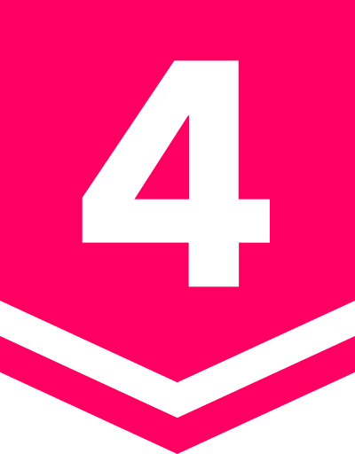

<!-- Generated by update_README.py. Edit problems.json for titles and levels. -->

# BOJ 17000–17999

[전체 구간](../README.md)

| No. | Title | Difficulty | Solution |
| --- | --- | --- | --- |
| [17009](https://www.acmicpc.net/problem/17009) | Winning Score |  | [C](./17009/17009.c) |
| [17010](https://www.acmicpc.net/problem/17010) | Time to Decompress |  | [Java](./17010/17010.java) |
| [17011](https://www.acmicpc.net/problem/17011) | Cold Compress |  | [Java](./17011/17011.java) |
| [17013](https://www.acmicpc.net/problem/17013) | Flipper |  | [Java](./17013/17013.java) |
| [17027](https://www.acmicpc.net/problem/17027) | Shell Game |  | [Java](./17027/17027.java) |
| [17033](https://www.acmicpc.net/problem/17033) | Cow Land |  | [C++](./17033/17033.cpp) |
| [17042](https://www.acmicpc.net/problem/17042) | Elder |  | [Java](./17042/17042.java) |
| [17069](https://www.acmicpc.net/problem/17069) | 파이프 옮기기 2 |  | [C++](./17069/17069.cpp) |
| [17070](https://www.acmicpc.net/problem/17070) | 파이프 옮기기 1 |  | [C++](./17070/17070.cpp) |
| [17071](https://www.acmicpc.net/problem/17071) | 숨바꼭질 5 |  | [C++](./17071/17071.cpp) |
| [17072](https://www.acmicpc.net/problem/17072) | 아스키 아트 |  | [Java](./17072/17072.java) |
| [17073](https://www.acmicpc.net/problem/17073) | 나무 위의 빗물 |  | [C++](./17073/17073.cpp) |
| [17074](https://www.acmicpc.net/problem/17074) | 정렬 |  | [C++](./17074/17074.cpp) |
| [17085](https://www.acmicpc.net/problem/17085) | 십자가 2개 놓기 |  | [C++](./17085/17085.cpp) |
| [17086](https://www.acmicpc.net/problem/17086) | 아기 상어 2 |  | [C++](./17086/17086.cpp) |
| [17087](https://www.acmicpc.net/problem/17087) | 숨바꼭질 6 |  | [C++](./17087/17087.cpp) |
| [17091](https://www.acmicpc.net/problem/17091) | 단어 시계 |  | [Java](./17091/17091.java) |
| [17093](https://www.acmicpc.net/problem/17093) | Total Circle |  | [Java](./17093/17093.java) |
| [17094](https://www.acmicpc.net/problem/17094) | Serious Problem |  | [Java](./17094/17094.java) |
| [17103](https://www.acmicpc.net/problem/17103) | 골드바흐 파티션 |  | [Java](./17103/17103.java) |
| [17104](https://www.acmicpc.net/problem/17104) | 골드바흐 파티션 2 |  | [C++](./17104/17104.cpp) |
| [17106](https://www.acmicpc.net/problem/17106) | 빙고 |  | [Text](./17106/17106.txt) |
| [17114](https://www.acmicpc.net/problem/17114) | 하이퍼 토마토 |  | [C++](./17114/17114.cpp) |
| [17117](https://www.acmicpc.net/problem/17117) | 평가 |  | [C++](./17117/17117.cpp) |
| [17122](https://www.acmicpc.net/problem/17122) | 체스 |  | [Java](./17122/17122.java) |
| [17127](https://www.acmicpc.net/problem/17127) | 벚꽃이 정보섬에 피어난 이유 |  | [C++](./17127/17127.cpp) |
| [17128](https://www.acmicpc.net/problem/17128) | 소가 정보섬에 올라온 이유 |  | [C++](./17128/17128.cpp) |
| [17129](https://www.acmicpc.net/problem/17129) | 윌리암슨수액빨이딱따구리가 정보섬에 올라온 이유 |  | [C++](./17129/17129.cpp) |
| [17131](https://www.acmicpc.net/problem/17131) | 여우가 정보섬에 올라온 이유 |  | [C++](./17131/17131.cpp) |
| [17134](https://www.acmicpc.net/problem/17134) | 르모앙의 추측 |  | [C++](./17134/17134.cpp) |
| [17141](https://www.acmicpc.net/problem/17141) | 연구소 2 |  | [C++](./17141/17141.cpp) |
| [17142](https://www.acmicpc.net/problem/17142) | 연구소 3 |  | [C++](./17142/17142.cpp) |
| [17143](https://www.acmicpc.net/problem/17143) | 낚시왕 |  | [C++](./17143/17143.cpp) |
| [17144](https://www.acmicpc.net/problem/17144) | 미세먼지 안녕! |  | [C++](./17144/17144.cpp) |
| [17162](https://www.acmicpc.net/problem/17162) | 가희의 수열놀이 (Small) |  | [C++](./17162/17162.cpp) |
| [17173](https://www.acmicpc.net/problem/17173) | 배수들의 합 |  | [Java](./17173/17173.java) |
| [17174](https://www.acmicpc.net/problem/17174) | 전체 계산 횟수 |  | [Java](./17174/17174.java) |
| [17175](https://www.acmicpc.net/problem/17175) | 피보나치는 지겨웡~ |  | [C++](./17175/17175.cpp) |
| [17176](https://www.acmicpc.net/problem/17176) | 암호해독기 |  | [Java](./17176/17176.java) |
| [17177](https://www.acmicpc.net/problem/17177) | 내접사각형 만들기 |  | [C++](./17177/17177.cpp) |
| [17179](https://www.acmicpc.net/problem/17179) | 케이크 자르기 |  | [C++](./17179/17179.cpp) |
| [17201](https://www.acmicpc.net/problem/17201) | 자석 체인 |  | [Java](./17201/17201.java) |
| [17202](https://www.acmicpc.net/problem/17202) | 핸드폰 번호 궁합 |  | [Java](./17202/17202.java) |
| [17204](https://www.acmicpc.net/problem/17204) | 죽음의 게임 |  | [C++](./17204/17204.cpp) |
| [17206](https://www.acmicpc.net/problem/17206) | 준석이의 수학 숙제 |  | [Java](./17206/17206.java) |
| [17210](https://www.acmicpc.net/problem/17210) | 문문문 |  | [Java](./17210/17210.java) |
| [17211](https://www.acmicpc.net/problem/17211) | 좋은 날 싫은 날 |  | [C++](./17211/17211.cpp) |
| [17212](https://www.acmicpc.net/problem/17212) | 달나라 토끼를 위한 구매대금 지불 도우미 |  | [C++](./17212/17212.cpp) |
| [17213](https://www.acmicpc.net/problem/17213) | 과일 서리 |  | [C++](./17213/17213.cpp) |
| [17216](https://www.acmicpc.net/problem/17216) | 가장 큰 감소 부분 수열 |  | [Java](./17216/17216.java) |
| [17218](https://www.acmicpc.net/problem/17218) | 비밀번호 만들기 |  | [C++](./17218/17218.cpp) |
| [17219](https://www.acmicpc.net/problem/17219) | 비밀번호 찾기 |  | [C++](./17219/17219.cpp) [Java](./17219/17219.java) |
| [17222](https://www.acmicpc.net/problem/17222) | 위스키 거래 |  | [C++](./17222/17222.cpp) |
| [17224](https://www.acmicpc.net/problem/17224) | APC는 왜 서브태스크 대회가 되었을까? |  | [Java](./17224/17224.java) |
| [17225](https://www.acmicpc.net/problem/17225) | 세훈이의 선물가게 |  | [C++](./17225/17225.cpp) |
| [17238](https://www.acmicpc.net/problem/17238) | Delicious Pineapple Pizza |  | [C++](./17238/17238.cpp) |
| [17241](https://www.acmicpc.net/problem/17241) | Pineapple Advertising |  | [C++](./17241/17241.cpp) |
| [17247](https://www.acmicpc.net/problem/17247) | 택시 거리 |  | [Java](./17247/17247.java) |
| [17249](https://www.acmicpc.net/problem/17249) | 태보태보 총난타 |  | [Java](./17249/17249.java) |
| [17250](https://www.acmicpc.net/problem/17250) | 은하철도 |  | [Java](./17250/17250.java) |
| [17252](https://www.acmicpc.net/problem/17252) | 삼삼한 수 |  | [Java](./17252/17252.java) |
| [17253](https://www.acmicpc.net/problem/17253) | 삼삼한 수 2 |  | [Java](./17253/17253.java) |
| [17256](https://www.acmicpc.net/problem/17256) | 달달함이 넘쳐흘러 |  | [C](./17256/17256.c) |
| [17263](https://www.acmicpc.net/problem/17263) | Sort 마스터 배지훈 |  | [Java](./17263/17263.java) |
| [17265](https://www.acmicpc.net/problem/17265) | 나의 인생에는 수학과 함께 |  | [C++](./17265/17265.cpp) |
| [17266](https://www.acmicpc.net/problem/17266) | 어두운 굴다리 |  | [C++](./17266/17266.cpp) |
| [17268](https://www.acmicpc.net/problem/17268) | 미팅의 저주 |  | [Java](./17268/17268.java) |
| [17269](https://www.acmicpc.net/problem/17269) | 이름궁합 테스트 |  | [Java](./17269/17269.java) |
| [17270](https://www.acmicpc.net/problem/17270) | 연예인은 힘들어 |  | [C++](./17270/17270.cpp) |
| [17271](https://www.acmicpc.net/problem/17271) | 리그 오브 레전설 (Small) |  | [C++](./17271/17271.cpp) |
| [17273](https://www.acmicpc.net/problem/17273) | 카드 공장 (Small) |  | [Java](./17273/17273.java) |
| [17276](https://www.acmicpc.net/problem/17276) | 배열 돌리기 |  | [C++](./17276/17276.cpp) |
| [17283](https://www.acmicpc.net/problem/17283) | I am Groot |  | [Java](./17283/17283.java) |
| [17284](https://www.acmicpc.net/problem/17284) | Vending Machine |  | [Java](./17284/17284.java) |
| [17285](https://www.acmicpc.net/problem/17285) | XORChic |  | [Java](./17285/17285.java) |
| [17286](https://www.acmicpc.net/problem/17286) | 유미 |  | [Java](./17286/17286.java) |
| [17287](https://www.acmicpc.net/problem/17287) | The Deeper, The Better |  | [Java](./17287/17287.java) |
| [17288](https://www.acmicpc.net/problem/17288) | 3개만! |  | [Java](./17288/17288.java) |
| [17290](https://www.acmicpc.net/problem/17290) | Crazy_aRcade_Good |  | [C++](./17290/17290.cpp) |
| [17292](https://www.acmicpc.net/problem/17292) | 바둑이 포커 |  | [C++](./17292/17292.cpp) |
| [17293](https://www.acmicpc.net/problem/17293) | 맥주 99병 |  | [Java](./17293/17293.java) |
| [17294](https://www.acmicpc.net/problem/17294) | 귀여운 수~ε٩(๑&gt; ₃ &lt;)۶з |  | [Java](./17294/17294.java) |
| [17295](https://www.acmicpc.net/problem/17295) | 엔드게임 스포일러 |  | [Java](./17295/17295.java) |
| [17296](https://www.acmicpc.net/problem/17296) | But can you do it in 0.5x A presses? |  | [C++](./17296/17296.cpp) |
| [17298](https://www.acmicpc.net/problem/17298) | 오큰수 |  | [C++](./17298/17298.cpp) |
| [17299](https://www.acmicpc.net/problem/17299) | 오등큰수 |  | [C++](./17299/17299.cpp) |
| [17305](https://www.acmicpc.net/problem/17305) | 사탕 배달 |  | [C++](./17305/17305.cpp) |
| [17347](https://www.acmicpc.net/problem/17347) | Text Editor |  | [C++](./17347/17347.cpp) |
| [17350](https://www.acmicpc.net/problem/17350) | 2루수 이름이 뭐야 |  | [Java](./17350/17350.java) |
| [17352](https://www.acmicpc.net/problem/17352) | 여러분의 다리가 되어 드리겠습니다! |  | [Java](./17352/17352.java) |
| [17356](https://www.acmicpc.net/problem/17356) | 욱 제 |  | [C](./17356/17356.c) |
| [17358](https://www.acmicpc.net/problem/17358) | 복불복으로 지구 멸망 |  | [C++](./17358/17358.cpp) |
| [17362](https://www.acmicpc.net/problem/17362) | 수학은 체육과목 입니다 2 |  | [Java](./17362/17362.java) |
| [17363](https://www.acmicpc.net/problem/17363) | 우유가 넘어지면? |  | [Java](./17363/17363.java) |
| [17386](https://www.acmicpc.net/problem/17386) | 선분 교차 1 |  | [C++](./17386/17386.cpp) |
| [17387](https://www.acmicpc.net/problem/17387) | 선분 교차 2 |  | [C++](./17387/17387.cpp) |
| [17388](https://www.acmicpc.net/problem/17388) | 와글와글 숭고한 |  | [C](./17388/17388.c) |
| [17389](https://www.acmicpc.net/problem/17389) | 보너스 점수 |  | [Java](./17389/17389.java) |
| [17390](https://www.acmicpc.net/problem/17390) | 이건 꼭 풀어야 해! |  | [C++](./17390/17390.cpp) |
| [17391](https://www.acmicpc.net/problem/17391) | 무한부스터 |  | [C++](./17391/17391.cpp) |
| [17394](https://www.acmicpc.net/problem/17394) | 핑거 스냅 |  | [C++](./17394/17394.cpp) |
| [17396](https://www.acmicpc.net/problem/17396) | 백도어 |  | [Java](./17396/17396.java) |
| [17398](https://www.acmicpc.net/problem/17398) | 통신망 분할 |  | [C++](./17398/17398.cpp) |
| [17399](https://www.acmicpc.net/problem/17399) | 트리의 외심 |  | [C++](./17399/17399.cpp) |
| [17401](https://www.acmicpc.net/problem/17401) | 일하는 세포 |  | [C++](./17401/17401.cpp) |
| [17402](https://www.acmicpc.net/problem/17402) | 시간 끌기 |  | [C++](./17402/17402.cpp) |
| [17403](https://www.acmicpc.net/problem/17403) | 가장 높고 넓은 성 |  | [C++](./17403/17403.cpp) |
| [17404](https://www.acmicpc.net/problem/17404) | RGB거리 2 |  | [C++](./17404/17404.cpp) |
| [17408](https://www.acmicpc.net/problem/17408) | 수열과 쿼리 24 |  | [C++](./17408/17408.cpp) |
| [17409](https://www.acmicpc.net/problem/17409) | 증가 수열의 개수 |  | [C++](./17409/17409.cpp) |
| [17410](https://www.acmicpc.net/problem/17410) | 수열과 쿼리 1.5 |  | [C++](./17410/17410.cpp) |
| [17412](https://www.acmicpc.net/problem/17412) | 도시 왕복하기 1 |  | [C++](./17412/17412.cpp) |
| [17413](https://www.acmicpc.net/problem/17413) | 단어 뒤집기 2 |  | [Java](./17413/17413.java) |
| [17419](https://www.acmicpc.net/problem/17419) | 비트가 넘쳐흘러 |  | [C++](./17419/17419.cpp) |
| [17425](https://www.acmicpc.net/problem/17425) | 약수의 합 |  | [C++](./17425/17425.cpp) |
| [17427](https://www.acmicpc.net/problem/17427) | 약수의 합 2 |  | [C++](./17427/17427.cpp) |
| [17435](https://www.acmicpc.net/problem/17435) | 합성함수와 쿼리 |  | [Java](./17435/17435.java) |
| [17436](https://www.acmicpc.net/problem/17436) | 소수의 배수 |  | [C++](./17436/17436.cpp) |
| [17450](https://www.acmicpc.net/problem/17450) | 과자 사기 |  | [Java](./17450/17450.java) |
| [17451](https://www.acmicpc.net/problem/17451) | 평행 우주 |  | [C++](./17451/17451.cpp) |
| [17452](https://www.acmicpc.net/problem/17452) | Christmalo.win |  | [C++](./17452/17452.cpp) |
| [17466](https://www.acmicpc.net/problem/17466) | N! mod P (1) |  | [Java](./17466/17466.java) |
| [17472](https://www.acmicpc.net/problem/17472) | 다리 만들기 2 |  | [Java](./17472/17472.java) |
| [17473](https://www.acmicpc.net/problem/17473) | 수열과 쿼리 25 |  | [C++](./17473/17473.cpp) |
| [17474](https://www.acmicpc.net/problem/17474) | 수열과 쿼리 26 |  | [C++](./17474/17474.cpp) |
| [17476](https://www.acmicpc.net/problem/17476) | 수열과 쿼리 28 |  | [C++](./17476/17476.cpp) |
| [17477](https://www.acmicpc.net/problem/17477) | 수열과 쿼리 29 |  | [C++](./17477/17477.cpp) |
| [17478](https://www.acmicpc.net/problem/17478) | 재귀함수가 뭔가요? |  | [Java](./17478/17478.java) |
| [17481](https://www.acmicpc.net/problem/17481) | 최애 정하기 |  | [C++](./17481/17481.cpp) |
| [17484](https://www.acmicpc.net/problem/17484) | 진우의 달 여행 (Small) |  | [C++](./17484/17484.cpp) |
| [17485](https://www.acmicpc.net/problem/17485) | 진우의 달 여행 (Large) |  | [C++](./17485/17485.cpp) |
| [17487](https://www.acmicpc.net/problem/17487) | 타자 연습 |  | [Java](./17487/17487.java) |
| [17488](https://www.acmicpc.net/problem/17488) | 수강 바구니 |  | [C++](./17488/17488.cpp) |
| [17490](https://www.acmicpc.net/problem/17490) | 일감호에 다리 놓기 |  | [Java](./17490/17490.java) |
| [17496](https://www.acmicpc.net/problem/17496) | 스타후르츠 |  | [Java](./17496/17496.java) |
| [17502](https://www.acmicpc.net/problem/17502) | 클레어와 팰린드롬 |  | [Java](./17502/17502.java) |
| [17503](https://www.acmicpc.net/problem/17503) | 맥주 축제 |  | [C++](./17503/17503.cpp) |
| [17504](https://www.acmicpc.net/problem/17504) | 제리와 톰 2 |  | [C++](./17504/17504.cpp) |
| [17509](https://www.acmicpc.net/problem/17509) | And the Winner Is... Ourselves! |  | [C++](./17509/17509.cpp) |
| [17520](https://www.acmicpc.net/problem/17520) | Balanced String |  | [C++](./17520/17520.cpp) |
| [17521](https://www.acmicpc.net/problem/17521) | Byte Coin |  | [C++](./17521/17521.cpp) |
| [17526](https://www.acmicpc.net/problem/17526) | Star Trek |  | [C++](./17526/17526.cpp) |
| [17530](https://www.acmicpc.net/problem/17530) | Buffoon |  | [Java](./17530/17530.java) |
| [17548](https://www.acmicpc.net/problem/17548) | Greetings! |  | [Java](./17548/17548.java) |
| [17575](https://www.acmicpc.net/problem/17575) | Kings |  | [C++](./17575/17575.cpp) |
| [17576](https://www.acmicpc.net/problem/17576) | Last Word |  | [Java](./17576/17576.java) |
| [17577](https://www.acmicpc.net/problem/17577) | Scores of Final Examination |  | [Java](./17577/17577.java) |
| [17588](https://www.acmicpc.net/problem/17588) | Missing Numbers |  | [Java](./17588/17588.java) |
| [17598](https://www.acmicpc.net/problem/17598) | Animal King Election |  | [Java](./17598/17598.java) |
| [17607](https://www.acmicpc.net/problem/17607) | 수열과 쿼리 31 |  | [C++](./17607/17607.cpp) |
| [17608](https://www.acmicpc.net/problem/17608) | 막대기 |  | [Java](./17608/17608.java) |
| [17609](https://www.acmicpc.net/problem/17609) | 회문 |  | [C++](./17609/17609.cpp) |
| [17610](https://www.acmicpc.net/problem/17610) | 양팔저울 |  | [C++](./17610/17610.cpp) |
| [17614](https://www.acmicpc.net/problem/17614) | 369 |  | [Java](./17614/17614.java) |
| [17615](https://www.acmicpc.net/problem/17615) | 볼 모으기 |  | [C++](./17615/17615.cpp) |
| [17618](https://www.acmicpc.net/problem/17618) | 신기한 수 |  | [Java](./17618/17618.java) |
| [17626](https://www.acmicpc.net/problem/17626) | Four Squares |  | [Java](./17626/17626.java) |
| [17689](https://www.acmicpc.net/problem/17689) | Candies |  | [C++](./17689/17689.cpp) |
| [17777](https://www.acmicpc.net/problem/17777) | Copy and Paste |  | [C++](./17777/17777.cpp) |
| [17783](https://www.acmicpc.net/problem/17783) | Breaking Branches |  | [Java](./17783/17783.java) |
| [17795](https://www.acmicpc.net/problem/17795) | Ballpark Estimate |  | [Java](./17795/17795.java) |
| [17826](https://www.acmicpc.net/problem/17826) | 나의 학점은? |  | [Java](./17826/17826.java) |
| [17827](https://www.acmicpc.net/problem/17827) | 달팽이 리스트 |  | [C++](./17827/17827.cpp) |
| [17828](https://www.acmicpc.net/problem/17828) | 문자열 화폐 |  | [C++](./17828/17828.cpp) |
| [17829](https://www.acmicpc.net/problem/17829) | 222-풀링 |  | [C++](./17829/17829.cpp) |
| [17836](https://www.acmicpc.net/problem/17836) | 공주님을 구해라! |  | [C++](./17836/17836.cpp) |
| [17838](https://www.acmicpc.net/problem/17838) | 커맨드 |  | [Java](./17838/17838.java) |
| [17841](https://www.acmicpc.net/problem/17841) | UNIST는 무엇의 약자일까? |  | [C++](./17841/17841.cpp) |
| [17843](https://www.acmicpc.net/problem/17843) | 시계 |  | [C++](./17843/17843.cpp) |
| [17845](https://www.acmicpc.net/problem/17845) | 수강 과목 |  | [C++](./17845/17845.cpp) |
| [17850](https://www.acmicpc.net/problem/17850) | Make America Grade Again |  | [Java](./17850/17850.java) |
| [17851](https://www.acmicpc.net/problem/17851) | This Problem’s a Slam Dunk |  | [Java](./17851/17851.java) |
| [17863](https://www.acmicpc.net/problem/17863) | FYI |  | [C](./17863/17863.c) |
| [17869](https://www.acmicpc.net/problem/17869) | Simple Collatz Sequence |  | [Java](./17869/17869.java) |
| [17874](https://www.acmicpc.net/problem/17874) | Piece of Cake! |  | [C](./17874/17874.c) |
| [17884](https://www.acmicpc.net/problem/17884) | Lost Lineup |  | [Java](./17884/17884.java) |
| [17889](https://www.acmicpc.net/problem/17889) | Mars Window |  | [Java](./17889/17889.java) |
| [17897](https://www.acmicpc.net/problem/17897) | Pea Soup and Pancakes |  | [Java](./17897/17897.java) |
| [17903](https://www.acmicpc.net/problem/17903) | Counting Clauses |  | [Java](./17903/17903.java) |
| [17912](https://www.acmicpc.net/problem/17912) | License to Launch |  | [Java](./17912/17912.java) |
| [17919](https://www.acmicpc.net/problem/17919) | Östgötska |  | [Java](./17919/17919.java) |
| [17924](https://www.acmicpc.net/problem/17924) | Cooking Water |  | [Java](./17924/17924.java) |
| [17927](https://www.acmicpc.net/problem/17927) | Counting Greedily Increasing Supersequences |  | [C++](./17927/17927.cpp) |
| [17930](https://www.acmicpc.net/problem/17930) | Hanging Out on the Terrace |  | [Java](./17930/17930.java) |
| [17931](https://www.acmicpc.net/problem/17931) | Greedily Increasing Subsequence |  | [C++](./17931/17931.cpp) |
| [17939](https://www.acmicpc.net/problem/17939) | Gazzzua |  | [C++](./17939/17939.cpp) |
| [17943](https://www.acmicpc.net/problem/17943) | 도미노 예측 |  | [C++](./17943/17943.cpp) |
| [17944](https://www.acmicpc.net/problem/17944) | 퐁당퐁당 1 |  | [Java](./17944/17944.java) |
| [17945](https://www.acmicpc.net/problem/17945) | 통학의 신 |  | [Java](./17945/17945.java) |
| [17946](https://www.acmicpc.net/problem/17946) | 피자는 나눌 수록 커지잖아요 |  | [Java](./17946/17946.java) |
| [17949](https://www.acmicpc.net/problem/17949) | Drop The Byte! |  | [Java](./17949/17949.java) |
| [17950](https://www.acmicpc.net/problem/17950) | 스노우볼 |  | [Java](./17950/17950.java) |
| [17951](https://www.acmicpc.net/problem/17951) | 흩날리는 시험지 속에서 내 평점이 느껴진거야 |  | [C++](./17951/17951.cpp) |
| [17952](https://www.acmicpc.net/problem/17952) | 과제는 끝나지 않아! |  | [C++](./17952/17952.cpp) |
| [17953](https://www.acmicpc.net/problem/17953) | 디저트 |  | [C++](./17953/17953.cpp) |
| [17975](https://www.acmicpc.net/problem/17975) | Strike Zone |  | [C++](./17975/17975.cpp) |
| [17987](https://www.acmicpc.net/problem/17987) | Howl |  | [Java](./17987/17987.java) |
| [17998](https://www.acmicpc.net/problem/17998) | Levenshtein Distance |  | [C++](./17998/17998.cpp) |
