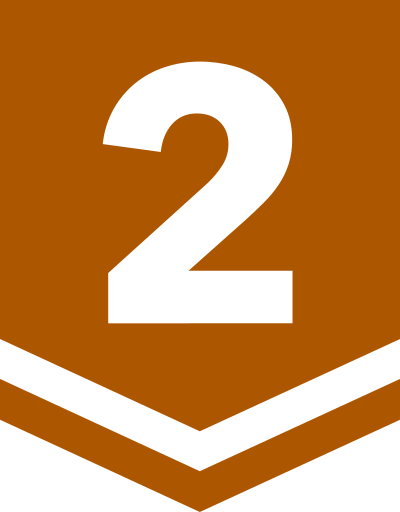

<!-- Generated by update_README.py. Edit problems.json for titles and levels. -->

# BOJ 21000–21999

[전체 구간](../README.md)

| No. | Title | Difficulty | Solution |
| --- | --- | --- | --- |
| [21022](https://www.acmicpc.net/problem/21022) | Three Points for a Win |  | [Java](./21022/21022.java) |
| [21047](https://www.acmicpc.net/problem/21047) | Array of Discord |  | [C++](./21047/21047.cpp) |
| [21049](https://www.acmicpc.net/problem/21049) | Coin Stacks |  | [C++](./21049/21049.cpp) |
| [21050](https://www.acmicpc.net/problem/21050) | Dams in Distress |  | [C++](./21050/21050.cpp) |
| [21052](https://www.acmicpc.net/problem/21052) | Film Critics |  | [C++](./21052/21052.cpp) |
| [21053](https://www.acmicpc.net/problem/21053) | Gig Combinatorics |  | [C++](./21053/21053.cpp) |
| [21056](https://www.acmicpc.net/problem/21056) | Joining Flows |  | [C++](./21056/21056.cpp) |
| [21057](https://www.acmicpc.net/problem/21057) | Keep Calm And Carry Off |  | [C++](./21057/21057.cpp) |
| [21059](https://www.acmicpc.net/problem/21059) | Methodic Multiplication |  | [Java](./21059/21059.java) |
| [21063](https://www.acmicpc.net/problem/21063) | Display of Springs |  | [C++](./21063/21063.cpp) |
| [21105](https://www.acmicpc.net/problem/21105) | New Financial Year |  | [Java](./21105/21105.java) |
| [21112](https://www.acmicpc.net/problem/21112) | Easter Gift |  | [C++](./21112/21112.cpp) |
| [21127](https://www.acmicpc.net/problem/21127) | Binary Supersonic Utahraptors |  | [C++](./21127/21127.cpp) |
| [21138](https://www.acmicpc.net/problem/21138) | Dominating Duos |  | [C++](./21138/21138.cpp) |
| [21143](https://www.acmicpc.net/problem/21143) | Magic Trick |  | [Java](./21143/21143.java) |
| [21144](https://www.acmicpc.net/problem/21144) | Missing Number |  | [Java](./21144/21144.java) |
| [21146](https://www.acmicpc.net/problem/21146) | Rating Problems |  | [Java](./21146/21146.java) |
| [21167](https://www.acmicpc.net/problem/21167) | Curve Speed |  | [Java](./21167/21167.java) |
| [21176](https://www.acmicpc.net/problem/21176) | Smoothie Stand |  | [C++](./21176/21176.cpp) |
| [21180](https://www.acmicpc.net/problem/21180) | Reconstruct Sum |  | [Java](./21180/21180.java) |
| [21185](https://www.acmicpc.net/problem/21185) | Some Sum |  | [Java](./21185/21185.java) |
| [21191](https://www.acmicpc.net/problem/21191) | This Ain't Your Grandpa's Checkerboard |  | [Java](./21191/21191.java) |
| [21197](https://www.acmicpc.net/problem/21197) | Stopwatch |  | [Java](./21197/21197.java) |
| [21200](https://www.acmicpc.net/problem/21200) | Forced Choice |  | [Java](./21200/21200.java) |
| [21212](https://www.acmicpc.net/problem/21212) | Cakes |  | [Java](./21212/21212.java) |
| [21275](https://www.acmicpc.net/problem/21275) | 폰 호석만 |  | [C++](./21275/21275.cpp) |
| [21276](https://www.acmicpc.net/problem/21276) | 계보 복원가 호석 |  | [C++](./21276/21276.cpp) |
| [21278](https://www.acmicpc.net/problem/21278) | 호석이 두 마리 치킨 |  | [C++](./21278/21278.cpp) |
| [21280](https://www.acmicpc.net/problem/21280) | Förvirrad föreläsare |  | [Java](./21280/21280.java) |
| [21287](https://www.acmicpc.net/problem/21287) | Färgrobot |  | [C++](./21287/21287.cpp) |
| [21293](https://www.acmicpc.net/problem/21293) | No Description 2 | — | [C++](./21293/21293.cpp) |
| [21300](https://www.acmicpc.net/problem/21300) | Bottle Return |  | [C](./21300/21300.c) |
| [21301](https://www.acmicpc.net/problem/21301) | Comfy Deviations |  | [Java](./21301/21301.java) |
| [21312](https://www.acmicpc.net/problem/21312) | 홀짝 칵테일 |  | [Java](./21312/21312.java) |
| [21313](https://www.acmicpc.net/problem/21313) | 문어 |  | [Java](./21313/21313.java) |
| [21314](https://www.acmicpc.net/problem/21314) | 민겸 수 |  | [C++](./21314/21314.cpp) |
| [21316](https://www.acmicpc.net/problem/21316) | 스피카 |  | [C++](./21316/21316.cpp) |
| [21317](https://www.acmicpc.net/problem/21317) | 징검다리 건너기 |  | [C++](./21317/21317.cpp) |
| [21318](https://www.acmicpc.net/problem/21318) | 피아노 체조 |  | [C++](./21318/21318.cpp) |
| [21335](https://www.acmicpc.net/problem/21335) | Another Eruption |  | [Java](./21335/21335.java) |
| [21339](https://www.acmicpc.net/problem/21339) | Contest Struggles |  | [Java](./21339/21339.java) |
| [21354](https://www.acmicpc.net/problem/21354) | Äpplen och päron |  | [Java](./21354/21354.java) |
| [21355](https://www.acmicpc.net/problem/21355) | Personnummer |  | [Java](./21355/21355.java) |
| [21394](https://www.acmicpc.net/problem/21394) | 숫자 카드 |  | [C++](./21394/21394.cpp) |
| [21406](https://www.acmicpc.net/problem/21406) | Строка |  | [Java](./21406/21406.java) |
| [21412](https://www.acmicpc.net/problem/21412) | Дробь |  | [Java](./21412/21412.java) |
| [21420](https://www.acmicpc.net/problem/21420) | Монетки |  | [Java](./21420/21420.java) |
| [21444](https://www.acmicpc.net/problem/21444) | Космические захватчики |  | [Java](./21444/21444.java) |
| [21507](https://www.acmicpc.net/problem/21507) | POBEDA-2014 |  | [Java](./21507/21507.java) |
| [21529](https://www.acmicpc.net/problem/21529) | Кастинг |  | [Java](./21529/21529.java) |
| [21530](https://www.acmicpc.net/problem/21530) | Города |  | [C++](./21530/21530.cpp) |
| [21553](https://www.acmicpc.net/problem/21553) | 암호 만들기 |  | [Java](./21553/21553.java) |
| [21557](https://www.acmicpc.net/problem/21557) | 불꽃놀이 |  | [C++](./21557/21557.cpp) |
| [21567](https://www.acmicpc.net/problem/21567) | 숫자의 개수 2 |  | [Java](./21567/21567.java) |
| [21573](https://www.acmicpc.net/problem/21573) | Кондиционер |  | [Java](./21573/21573.java) |
| [21591](https://www.acmicpc.net/problem/21591) | Laptop Sticker |  | [Java](./21591/21591.java) |
| [21598](https://www.acmicpc.net/problem/21598) | SciComLove |  | [C](./21598/21598.c) |
| [21600](https://www.acmicpc.net/problem/21600) | 계단 |  | [C++](./21600/21600.cpp) |
| [21603](https://www.acmicpc.net/problem/21603) | K 2K 게임 |  | [Java](./21603/21603.java) |
| [21608](https://www.acmicpc.net/problem/21608) | 상어 초등학교 |  | [C++](./21608/21608.cpp) |
| [21611](https://www.acmicpc.net/problem/21611) | 마법사 상어와 블리자드 |  | [C++](./21611/21611.cpp) |
| [21612](https://www.acmicpc.net/problem/21612) | Boiling Water |  | [C](./21612/21612.c) |
| [21613](https://www.acmicpc.net/problem/21613) | Silent Auction |  | [Java](./21613/21613.java) |
| [21614](https://www.acmicpc.net/problem/21614) | Secret Instructions |  | [Java](./21614/21614.java) |
| [21617](https://www.acmicpc.net/problem/21617) | Crazy Fencing |  | [Java](./21617/21617.java) |
| [21631](https://www.acmicpc.net/problem/21631) | Checkers |  | [Java](./21631/21631.java) |
| [21633](https://www.acmicpc.net/problem/21633) | Bank Transfer |  | [Java](./21633/21633.java) |
| [21638](https://www.acmicpc.net/problem/21638) | SMS from MCHS |  | [Java](./21638/21638.java) |
| [21645](https://www.acmicpc.net/problem/21645) | Ролевая игра |  | [Java](./21645/21645.java) |
| [21665](https://www.acmicpc.net/problem/21665) | Миша и негатив |  | [Java](./21665/21665.java) |
| [21666](https://www.acmicpc.net/problem/21666) | Треугольник Максима |  | [Python](./21666/21666.py) |
| [21675](https://www.acmicpc.net/problem/21675) | Черно-белая графика |  | [Java](./21675/21675.java) |
| [21679](https://www.acmicpc.net/problem/21679) | Клавиатура |  | [Java](./21679/21679.java) |
| [21734](https://www.acmicpc.net/problem/21734) | SMUPC의 등장 |  | [Java](./21734/21734.java) |
| [21735](https://www.acmicpc.net/problem/21735) | 눈덩이 굴리기 |  | [C++](./21735/21735.cpp) |
| [21736](https://www.acmicpc.net/problem/21736) | 헌내기는 친구가 필요해 |  | [C++](./21736/21736.cpp) |
| [21756](https://www.acmicpc.net/problem/21756) | 지우개 |  | [Java](./21756/21756.java) |
| [21758](https://www.acmicpc.net/problem/21758) | 꿀 따기 |  | [C++](./21758/21758.cpp) |
| [21760](https://www.acmicpc.net/problem/21760) | 야구 시즌 |  | [C++](./21760/21760.cpp) |
| [21771](https://www.acmicpc.net/problem/21771) | 가희야 거기서 자는 거 아니야 |  | [Java](./21771/21771.java) |
| [21772](https://www.acmicpc.net/problem/21772) | 가희의 고구마 먹방 |  | [C++](./21772/21772.cpp) |
| [21773](https://www.acmicpc.net/problem/21773) | 가희와 프로세스 1 |  | [C++](./21773/21773.cpp) |
| [21778](https://www.acmicpc.net/problem/21778) | 가희와 프로세스 2 |  | [C++](./21778/21778.cpp) |
| [21866](https://www.acmicpc.net/problem/21866) | 추첨을 통해 커피를 받자 |  | [Java](./21866/21866.java) |
| [21867](https://www.acmicpc.net/problem/21867) | Java Bitecode |  | [Java](./21867/21867.java) |
| [21869](https://www.acmicpc.net/problem/21869) | Maximum Bishop |  | [C++](./21869/21869.cpp) |
| [21870](https://www.acmicpc.net/problem/21870) | 시철이가 사랑한 GCD |  | [C++](./21870/21870.cpp) |
| [21875](https://www.acmicpc.net/problem/21875) | Innohorse |  | [C++](./21875/21875.cpp) |
| [21895](https://www.acmicpc.net/problem/21895) | Rock-Paper-Scissors for three |  | [Python](./21895/21895.py) |
| [21905](https://www.acmicpc.net/problem/21905) | Archeologists |  | [C++](./21905/21905.cpp) |
| [21918](https://www.acmicpc.net/problem/21918) | 전구 |  | [Java](./21918/21918.java) |
| [21919](https://www.acmicpc.net/problem/21919) | 소수 최소 공배수 |  | [C++](./21919/21919.cpp) |
| [21920](https://www.acmicpc.net/problem/21920) | 서로소 평균 |  | [C++](./21920/21920.cpp) |
| [21921](https://www.acmicpc.net/problem/21921) | 블로그 |  | [C++](./21921/21921.cpp) |
| [21924](https://www.acmicpc.net/problem/21924) | 도시 건설 |  | [Java](./21924/21924.java) |
| [21937](https://www.acmicpc.net/problem/21937) | 작업 |  | [C++](./21937/21937.cpp) |
| [21938](https://www.acmicpc.net/problem/21938) | 영상처리 |  | [C++](./21938/21938.cpp) |
| [21939](https://www.acmicpc.net/problem/21939) | 문제 추천 시스템 Version 1 |  | [C++](./21939/21939.cpp) |
| [21940](https://www.acmicpc.net/problem/21940) | 가운데에서 만나기 |  | [C++](./21940/21940.cpp) |
| [21945](https://www.acmicpc.net/problem/21945) | Palindromes |  | [Java](./21945/21945.java) |
| [21955](https://www.acmicpc.net/problem/21955) | Split |  | [Java](./21955/21955.java) |
| [21964](https://www.acmicpc.net/problem/21964) | 선린인터넷고등학교 교가 |  | [Java](./21964/21964.java) |
| [21965](https://www.acmicpc.net/problem/21965) | 드높은 남산 위에 우뚝 선 |  | [C++](./21965/21965.cpp) |
| [21966](https://www.acmicpc.net/problem/21966) | (중략) |  | [C++](./21966/21966.cpp) |
| [21967](https://www.acmicpc.net/problem/21967) | 세워라 반석 위에 |  | [C++](./21967/21967.cpp) |
| [21968](https://www.acmicpc.net/problem/21968) | 선린의 터를 |  | [C++](./21968/21968.cpp) |
| [21982](https://www.acmicpc.net/problem/21982) | 상자 빌리기 |  | [C++](./21982/21982.cpp) |
| [21983](https://www.acmicpc.net/problem/21983) | Basalt Breakdown |  | [Java](./21983/21983.java) |
