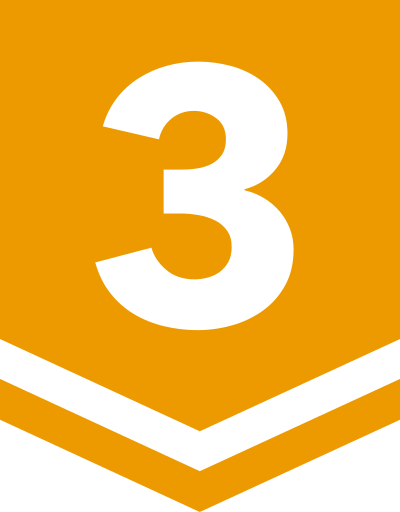
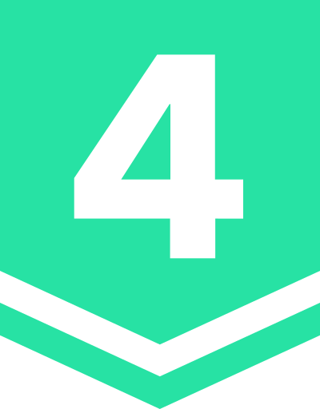

<!-- Generated by update_README.py. Edit problems.json for titles and levels. -->

# BOJ 24000–24999

[전체 구간](../README.md)

| No. | Title | Difficulty | Solution |
| --- | --- | --- | --- |
| [24024](https://www.acmicpc.net/problem/24024) | 삼색 그래프 |  | [C++](./24024/24024.cpp) |
| [24039](https://www.acmicpc.net/problem/24039) | 2021은 무엇이 특별할까? |  | [Java](./24039/24039.java) |
| [24049](https://www.acmicpc.net/problem/24049) | 정원 (Easy) |  | [Java](./24049/24049.java) |
| [24051](https://www.acmicpc.net/problem/24051) | 알고리즘 수업 - 삽입 정렬 1 |  | [Java](./24051/24051.java) |
| [24052](https://www.acmicpc.net/problem/24052) | 알고리즘 수업 - 삽입 정렬 2 |  | [Java](./24052/24052.java) |
| [24060](https://www.acmicpc.net/problem/24060) | 알고리즘 수업 - 병합 정렬 1 |  | [Java](./24060/24060.java) |
| [24072](https://www.acmicpc.net/problem/24072) | 帰省 (Homecoming) |  | [Java](./24072/24072.java) |
| [24073](https://www.acmicpc.net/problem/24073) | ビ太郎と IOI (Bitaro and IOI) |  | [Java](./24073/24073.java) |
| [24074](https://www.acmicpc.net/problem/24074) | 分割 (Split) |  | [Java](./24074/24074.java) |
| [24075](https://www.acmicpc.net/problem/24075) | 計算 (Calculation) |  | [Java](./24075/24075.java) |
| [24076](https://www.acmicpc.net/problem/24076) | IOI 文字列 (IOI String) |  | [Java](./24076/24076.java) |
| [24077](https://www.acmicpc.net/problem/24077) | 比較 (Comparison) |  | [Java](./24077/24077.java) |
| [24078](https://www.acmicpc.net/problem/24078) | 余り (Remainder) |  | [C](./24078/24078.c) |
| [24079](https://www.acmicpc.net/problem/24079) | 移動 (Moving) |  | [Java](./24079/24079.java) |
| [24080](https://www.acmicpc.net/problem/24080) | 複雑な文字列 (Complex String) |  | [Java](./24080/24080.java) |
| [24081](https://www.acmicpc.net/problem/24081) | 箱と鍵 (Boxes and Keys) |  | [Java](./24081/24081.java) |
| [24082](https://www.acmicpc.net/problem/24082) | 立方体 (Cube) |  | [C](./24082/24082.c) |
| [24083](https://www.acmicpc.net/problem/24083) | 短針 (Hour Hand) |  | [Java](./24083/24083.java) |
| [24084](https://www.acmicpc.net/problem/24084) | 次の文字 (Next Character) |  | [Java](./24084/24084.java) |
| [24085](https://www.acmicpc.net/problem/24085) | 希少な数 (Rare Number) |  | [Java](./24085/24085.java) |
| [24086](https://www.acmicpc.net/problem/24086) | 身長 (Height) |  | [Java](./24086/24086.java) |
| [24087](https://www.acmicpc.net/problem/24087) | アイスクリーム (Ice Cream) |  | [Java](./24087/24087.java) |
| [24088](https://www.acmicpc.net/problem/24088) | 運動会 (Sports Day) |  | [Java](./24088/24088.java) |
| [24089](https://www.acmicpc.net/problem/24089) | ボールの移動 (Moving Balls) |  | [Java](./24089/24089.java) |
| [24090](https://www.acmicpc.net/problem/24090) | 알고리즘 수업 - 퀵 정렬 1 |  | [Java](./24090/24090.java) |
| [24091](https://www.acmicpc.net/problem/24091) | 알고리즘 수업 - 퀵 정렬 2 |  | [Java](./24091/24091.java) |
| [24116](https://www.acmicpc.net/problem/24116) | 本選会場 (Finals) |  | [Java](./24116/24116.java) |
| [24123](https://www.acmicpc.net/problem/24123) | コンテスト (Contest) |  | [C++](./24123/24123.cpp) |
| [24137](https://www.acmicpc.net/problem/24137) | 塗り箸 (Chopsticks) |  | [C++](./24137/24137.cpp) |
| [24183](https://www.acmicpc.net/problem/24183) | Affischutskicket |  | [Java](./24183/24183.java) |
| [24196](https://www.acmicpc.net/problem/24196) | Gömda ord |  | [Java](./24196/24196.java) |
| [24197](https://www.acmicpc.net/problem/24197) | Tabbtabbande |  | [Python](./24197/24197.py) |
| [24198](https://www.acmicpc.net/problem/24198) | Muffinspelet |  | [Java](./24198/24198.java) |
| [24228](https://www.acmicpc.net/problem/24228) | 젓가락 |  | [C++](./24228/24228.cpp) |
| [24230](https://www.acmicpc.net/problem/24230) | 트리 색칠하기 |  | [C++](./24230/24230.cpp) |
| [24262](https://www.acmicpc.net/problem/24262) | 알고리즘 수업 - 알고리즘의 수행 시간 1 |  | [C](./24262/24262.c) |
| [24263](https://www.acmicpc.net/problem/24263) | 알고리즘 수업 - 알고리즘의 수행 시간 2 |  | [C](./24263/24263.c) |
| [24264](https://www.acmicpc.net/problem/24264) | 알고리즘 수업 - 알고리즘의 수행 시간 3 |  | [Java](./24264/24264.java) |
| [24265](https://www.acmicpc.net/problem/24265) | 알고리즘 수업 - 알고리즘의 수행 시간 4 |  | [Java](./24265/24265.java) |
| [24266](https://www.acmicpc.net/problem/24266) | 알고리즘 수업 - 알고리즘의 수행 시간 5 |  | [Java](./24266/24266.java) |
| [24267](https://www.acmicpc.net/problem/24267) | 알고리즘 수업 - 알고리즘의 수행 시간 6 |  | [Java](./24267/24267.java) |
| [24293](https://www.acmicpc.net/problem/24293) | ВСЕКИ ТРЕТИ |  | [C++](./24293/24293.cpp) |
| [24294](https://www.acmicpc.net/problem/24294) | ГРАДИНА |  | [Java](./24294/24294.java) |
| [24296](https://www.acmicpc.net/problem/24296) | ЛИНИЯ |  | [Java](./24296/24296.java) |
| [24302](https://www.acmicpc.net/problem/24302) | КУРИЕРИ |  | [Java](./24302/24302.java) |
| [24303](https://www.acmicpc.net/problem/24303) | ПРЪЧКИ |  | [Java](./24303/24303.java) |
| [24304](https://www.acmicpc.net/problem/24304) | ЧИСЛА МЕЖДУ БУКВИ |  | [C++](./24304/24304.cpp) |
| [24309](https://www.acmicpc.net/problem/24309) | РАВЕНСТВО |  | [Java](./24309/24309.java) |
| [24310](https://www.acmicpc.net/problem/24310) | БОЯДИСВАНЕ НА ОГРАДА |  | [Java](./24310/24310.java) |
| [24311](https://www.acmicpc.net/problem/24311) | ПЪТУВАНЕ |  | [Java](./24311/24311.java) |
| [24312](https://www.acmicpc.net/problem/24312) | ДИНИ |  | [Java](./24312/24312.java) |
| [24313](https://www.acmicpc.net/problem/24313) | 알고리즘 수업 - 점근적 표기 1 |  | [Java](./24313/24313.java) |
| [24314](https://www.acmicpc.net/problem/24314) | 알고리즘 수업 - 점근적 표기 2 |  | [C++](./24314/24314.cpp) |
| [24315](https://www.acmicpc.net/problem/24315) | 알고리즘 수업 - 점근적 표기 3 |  | [C++](./24315/24315.cpp) |
| [24325](https://www.acmicpc.net/problem/24325) | Making Change |  | [C++](./24325/24325.cpp) |
| [24333](https://www.acmicpc.net/problem/24333) | СРЕЩА НА ПРИЯТЕЛИ |  | [Java](./24333/24333.java) |
| [24346](https://www.acmicpc.net/problem/24346) | ПАЛИНДРОМ |  | [C++](./24346/24346.cpp) |
| [24347](https://www.acmicpc.net/problem/24347) | КАРТИ |  | [Java](./24347/24347.java) |
| [24348](https://www.acmicpc.net/problem/24348) | ИЗРАЗ |  | [Java](./24348/24348.java) |
| [24349](https://www.acmicpc.net/problem/24349) | МЕД |  | [Java](./24349/24349.java) |
| [24356](https://www.acmicpc.net/problem/24356) | ЧАСОВНИК |  | [Java](./24356/24356.java) |
| [24365](https://www.acmicpc.net/problem/24365) | ПЧЕЛИЧКАТА МАЯ |  | [Java](./24365/24365.java) |
| [24366](https://www.acmicpc.net/problem/24366) | КЛЕТКИ |  | [Java](./24366/24366.java) |
| [24376](https://www.acmicpc.net/problem/24376) | РЕДИЦА |  | [Java](./24376/24376.java) |
| [24377](https://www.acmicpc.net/problem/24377) | ИГРА |  | [C++](./24377/24377.cpp) |
| [24378](https://www.acmicpc.net/problem/24378) | КАСТИНГ |  | [Java](./24378/24378.java) |
| [24384](https://www.acmicpc.net/problem/24384) | ЗАПЛАТА |  | [Java](./24384/24384.java) |
| [24386](https://www.acmicpc.net/problem/24386) | КЛЕЧКИ |  | [Java](./24386/24386.java) |
| [24387](https://www.acmicpc.net/problem/24387) | ИЗЛОЖЕНИЕ НА ПЧЕЛЕН МЕД |  | [Java](./24387/24387.java) |
| [24389](https://www.acmicpc.net/problem/24389) | 2의 보수 |  | [Java](./24389/24389.java) |
| [24391](https://www.acmicpc.net/problem/24391) | 귀찮은 해강이 |  | [Java](./24391/24391.java) |
| [24395](https://www.acmicpc.net/problem/24395) | 명진이의 신년계획 |  | [C++](./24395/24395.cpp) |
| [24398](https://www.acmicpc.net/problem/24398) | 알고리즘 수업 - 선택 알고리즘 1 |  | [Java](./24398/24398.java) |
| [24399](https://www.acmicpc.net/problem/24399) | 알고리즘 수업 - 선택 알고리즘 2 |  | [Java](./24399/24399.java) |
| [24405](https://www.acmicpc.net/problem/24405) | Eye of Sauron |  | [Java](./24405/24405.java) |
| [24408](https://www.acmicpc.net/problem/24408) | Mult! |  | [Java](./24408/24408.java) |
| [24416](https://www.acmicpc.net/problem/24416) | 알고리즘 수업 - 피보나치 수 1 |  | [Java](./24416/24416.java) |
| [24417](https://www.acmicpc.net/problem/24417) | 알고리즘 수업 - 피보나치 수 2 |  | [Java](./24417/24417.java) |
| [24418](https://www.acmicpc.net/problem/24418) | 알고리즘 수업 - 행렬 경로 문제 1 |  | [Java](./24418/24418.java) |
| [24419](https://www.acmicpc.net/problem/24419) | 알고리즘 수업 - 행렬 경로 문제 2 |  | [C++](./24419/24419.cpp) |
| [24420](https://www.acmicpc.net/problem/24420) | ピアノコンクール (Piano Competition) |  | [Java](./24420/24420.java) |
| [24421](https://www.acmicpc.net/problem/24421) | 掛け算 (Multiplication) |  | [Java](./24421/24421.java) |
| [24444](https://www.acmicpc.net/problem/24444) | 알고리즘 수업 - 너비 우선 탐색 1 |  | [C++](./24444/24444.cpp) [Java](./24444/24444.java) |
| [24445](https://www.acmicpc.net/problem/24445) | 알고리즘 수업 - 너비 우선 탐색 2 |  | [Java](./24445/24445.java) |
| [24446](https://www.acmicpc.net/problem/24446) | 알고리즘 수업 - 너비 우선 탐색 3 |  | [Java](./24446/24446.java) |
| [24447](https://www.acmicpc.net/problem/24447) | 알고리즘 수업 - 너비 우선 탐색 4 |  | [Java](./24447/24447.java) |
| [24456](https://www.acmicpc.net/problem/24456) | 초콜릿 훔쳐 먹기 |  | [C++](./24456/24456.cpp) |
| [24458](https://www.acmicpc.net/problem/24458) | Prison Break |  | [C++](./24458/24458.cpp) |
| [24461](https://www.acmicpc.net/problem/24461) | 그래프의 줄기 |  | [C++](./24461/24461.cpp) |
| [24464](https://www.acmicpc.net/problem/24464) | 득수 밥 먹이기 |  | [C++](./24464/24464.cpp) |
| [24468](https://www.acmicpc.net/problem/24468) | 충돌의 수 |  | [C++](./24468/24468.cpp) |
| [24479](https://www.acmicpc.net/problem/24479) | 알고리즘 수업 - 깊이 우선 탐색 1 |  | [C++](./24479/24479.cpp) [Java](./24479/24479.java) |
| [24480](https://www.acmicpc.net/problem/24480) | 알고리즘 수업 - 깊이 우선 탐색 2 |  | [Java](./24480/24480.java) |
| [24481](https://www.acmicpc.net/problem/24481) | 알고리즘 수업 - 깊이 우선 탐색 3 |  | [Java](./24481/24481.java) |
| [24482](https://www.acmicpc.net/problem/24482) | 알고리즘 수업 - 깊이 우선 탐색 4 |  | [Java](./24482/24482.java) |
| [24483](https://www.acmicpc.net/problem/24483) | 알고리즘 수업 - 깊이 우선 탐색 5 |  | [Java](./24483/24483.java) |
| [24484](https://www.acmicpc.net/problem/24484) | 알고리즘 수업 - 깊이 우선 탐색 6 |  | [Java](./24484/24484.java) |
| [24499](https://www.acmicpc.net/problem/24499) | blobyum |  | [C++](./24499/24499.cpp) |
| [24500](https://www.acmicpc.net/problem/24500) | blobblush |  | [C++](./24500/24500.cpp) |
| [24505](https://www.acmicpc.net/problem/24505) | blobhyperthink |  | [C++](./24505/24505.cpp) |
| [24508](https://www.acmicpc.net/problem/24508) | 나도리팡 |  | [C++](./24508/24508.cpp) |
| [24509](https://www.acmicpc.net/problem/24509) | 상품의 주인은? |  | [C++](./24509/24509.cpp) |
| [24510](https://www.acmicpc.net/problem/24510) | 시간복잡도를 배운 도도 |  | [Java](./24510/24510.java) |
| [24511](https://www.acmicpc.net/problem/24511) | queuestack |  | [Java](./24511/24511.java) |
| [24512](https://www.acmicpc.net/problem/24512) | Bottleneck Travelling Salesman Problem (Small) |  | [C++](./24512/24512.cpp) |
| [24524](https://www.acmicpc.net/problem/24524) | 아름다운 문자열 |  | [C++](./24524/24524.cpp) |
| [24537](https://www.acmicpc.net/problem/24537) | 약수 계산 |  | [C++](./24537/24537.cpp) |
| [24542](https://www.acmicpc.net/problem/24542) | 튜터-튜티 관계의 수 |  | [Java](./24542/24542.java) |
| [24544](https://www.acmicpc.net/problem/24544) | 카카오뷰 큐레이팅 효용성 분석 |  | [Java](./24544/24544.java) |
| [24546](https://www.acmicpc.net/problem/24546) | 놀이기구에 진심인 편 |  | [C++](./24546/24546.cpp) |
| [24547](https://www.acmicpc.net/problem/24547) | mod와 쿼리 |  | [C++](./24547/24547.cpp) |
| [24549](https://www.acmicpc.net/problem/24549) | 신촌방위본부의 부대 배치 |  | [C++](./24549/24549.cpp) |
| [24551](https://www.acmicpc.net/problem/24551) | 일이 너무 많아... |  | [Java](./24551/24551.java) |
| [24568](https://www.acmicpc.net/problem/24568) | Cupcake Party |  | [C](./24568/24568.c) |
| [24569](https://www.acmicpc.net/problem/24569) | Fergusonball Ratings |  | [Java](./24569/24569.java) |
| [24578](https://www.acmicpc.net/problem/24578) | Ultimate Binary Watch |  | [Java](./24578/24578.java) |
| [24597](https://www.acmicpc.net/problem/24597) | Reversibly Cyclic Strings |  | [C++](./24597/24597.cpp) |
| [24603](https://www.acmicpc.net/problem/24603) | Scaling Recipe |  | [Java](./24603/24603.java) |
| [24606](https://www.acmicpc.net/problem/24606) | Double Password |  | [Java](./24606/24606.java) |
| [24608](https://www.acmicpc.net/problem/24608) | Average Character |  | [Java](./24608/24608.java) |
| [24609](https://www.acmicpc.net/problem/24609) | Overdraft |  | [Java](./24609/24609.java) |
| [24610](https://www.acmicpc.net/problem/24610) | Who Goes There? |  | [Java](./24610/24610.java) |
| [24623](https://www.acmicpc.net/problem/24623) | Изгороди |  | [Java](./24623/24623.java) |
| [24638](https://www.acmicpc.net/problem/24638) | Anno Domini 2022 |  | [Java](./24638/24638.java) |
| [24653](https://www.acmicpc.net/problem/24653) | Announcements |  | [C++](./24653/24653.cpp) |
| [24654](https://www.acmicpc.net/problem/24654) | Build The Grid |  | [C++](./24654/24654.cpp) |
| [24657](https://www.acmicpc.net/problem/24657) | Edges, Colors and MST |  | [C++](./24657/24657.cpp) |
| [24661](https://www.acmicpc.net/problem/24661) | Items and Heroes |  | [C++](./24661/24661.cpp) |
| [24723](https://www.acmicpc.net/problem/24723) | 녹색거탑 |  | [Java](./24723/24723.java) |
| [24724](https://www.acmicpc.net/problem/24724) | 현대모비스와 함께하는 부품 관리 |  | [Java](./24724/24724.java) |
| [24725](https://www.acmicpc.net/problem/24725) | 엠비티아이 |  | [C++](./24725/24725.cpp) |
| [24736](https://www.acmicpc.net/problem/24736) | Football Scoring |  | [C](./24736/24736.c) |
| [24747](https://www.acmicpc.net/problem/24747) | Letterle |  | [Java](./24747/24747.java) |
| [24751](https://www.acmicpc.net/problem/24751) | Betting |  | [C](./24751/24751.c) |
| [24765](https://www.acmicpc.net/problem/24765) | Mia |  | [Java](./24765/24765.java) |
| [24767](https://www.acmicpc.net/problem/24767) | Beehives |  | [Java](./24767/24767.java) |
| [24768](https://www.acmicpc.net/problem/24768) | Left Beehind |  | [Java](./24768/24768.java) |
| [24769](https://www.acmicpc.net/problem/24769) | Beekeeper |  | [Java](./24769/24769.java) |
| [24770](https://www.acmicpc.net/problem/24770) | Carousel Rides |  | [Java](./24770/24770.java) |
| [24783](https://www.acmicpc.net/problem/24783) | Number Fun |  | [Java](./24783/24783.java) |
| [24795](https://www.acmicpc.net/problem/24795) | Saving Princess Peach |  | [Java](./24795/24795.java) |
| [24798](https://www.acmicpc.net/problem/24798) | The Weight Of Words |  | [Java](./24798/24798.java) |
| [24803](https://www.acmicpc.net/problem/24803) | Provinces and Gold |  | [Java](./24803/24803.java) |
| [24805](https://www.acmicpc.net/problem/24805) | Climbing Worm |  | [Java](./24805/24805.java) |
| [24807](https://www.acmicpc.net/problem/24807) | Math Homework |  | [Java](./24807/24807.java) |
| [24810](https://www.acmicpc.net/problem/24810) | Bowser's Pipes |  | [C++](./24810/24810.cpp) |
| [24820](https://www.acmicpc.net/problem/24820) | Spelling Bee |  | [Java](./24820/24820.java) |
| [24830](https://www.acmicpc.net/problem/24830) | Broken Calculator |  | [Java](./24830/24830.java) |
| [24831](https://www.acmicpc.net/problem/24831) | Two Rabbits |  | [Java](./24831/24831.java) |
| [24843](https://www.acmicpc.net/problem/24843) | Friendly Rooks |  | [C++](./24843/24843.cpp) |
| [24855](https://www.acmicpc.net/problem/24855) | Natives |  | [C++](./24855/24855.cpp) |
| [24860](https://www.acmicpc.net/problem/24860) | Counting Antibodies |  | [Java](./24860/24860.java) |
| [24867](https://www.acmicpc.net/problem/24867) | Два станка |  | [Java](./24867/24867.java) |
| [24871](https://www.acmicpc.net/problem/24871) | Календарь на Альфе Центавра |  | [Java](./24871/24871.java) |
| [24883](https://www.acmicpc.net/problem/24883) | 자동완성 |  | [C](./24883/24883.c) |
| [24888](https://www.acmicpc.net/problem/24888) | 노트 조각 |  | [C++](./24888/24888.cpp) |
| [24900](https://www.acmicpc.net/problem/24900) | 한별 찍기 |  | [C](./24900/24900.c) |
| [24904](https://www.acmicpc.net/problem/24904) | Baekjoon Wordline Judge | — | [Text (alt)](./24904/24904-alt.txt) [Text](./24904/24904.txt) |
| [24905](https://www.acmicpc.net/problem/24905) | 24905번 문제 | — | [Text](./24905/24905.txt) |
| [24912](https://www.acmicpc.net/problem/24912) | 카드 색칠 |  | [C++](./24912/24912.cpp) |
| [24923](https://www.acmicpc.net/problem/24923) | Canadians, eh? |  | [Java](./24923/24923.java) |
| [24927](https://www.acmicpc.net/problem/24927) | Is It Even? |  | [Java](./24927/24927.java) |
| [24937](https://www.acmicpc.net/problem/24937) | SciComLove (2022) |  | [Java](./24937/24937.java) |
| [24938](https://www.acmicpc.net/problem/24938) | 키트 분배하기 |  | [C++](./24938/24938.cpp) |
| [24990](https://www.acmicpc.net/problem/24990) | Hamilton - The Musical |  | [C++](./24990/24990.cpp) |
