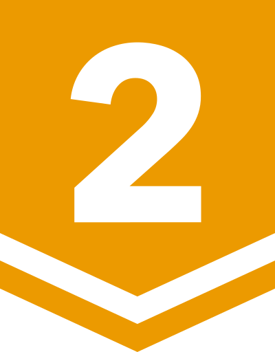

<!-- Generated by update_README.py. Edit problems.json for titles and levels. -->

# BOJ 35000–35999

[전체 구간](../README.md)

| No. | Title | Difficulty | Solution |
| --- | --- | --- | --- |
| [35030](https://www.acmicpc.net/problem/35030) | 2026년이 기대되는 이유 |  | [C++](./35030/35030.cpp) |
| [35052](https://www.acmicpc.net/problem/35052) | 끝내주는 분할 |  | [C++](./35052/35052.cpp) |
| [35077](https://www.acmicpc.net/problem/35077) | Fair Share | — | [C++](./35077/35077.cpp) |
| [35097](https://www.acmicpc.net/problem/35097) | 2025 |  | [C++](./35097/35097.cpp) |
| [35106](https://www.acmicpc.net/problem/35106) | 릴레이 가위바위보 게임 |  | [C++](./35106/35106.cpp) |
| [35112](https://www.acmicpc.net/problem/35112) | 으악그래프 |  | [C++](./35112/35112.cpp) |
| [35143](https://www.acmicpc.net/problem/35143) | $2026$ |  | [C++](./35143/35143.cpp) |
| [35146](https://www.acmicpc.net/problem/35146) | $02493$ |  | [C++](./35146/35146.cpp) |
| [35149](https://www.acmicpc.net/problem/35149) | NEMODEMIC |  | [C++](./35149/35149.cpp) |
| [35160](https://www.acmicpc.net/problem/35160) | 명사수 |  | [C++](./35160/35160.cpp) |
| [35162](https://www.acmicpc.net/problem/35162) | KCPC 스티커 만들기 |  | [C++](./35162/35162.cpp) |
| [35184](https://www.acmicpc.net/problem/35184) | 수돗물과 게 임 |  | [C++](./35184/35184.cpp) |
| [35185](https://www.acmicpc.net/problem/35185) | 바바와 깃발 게임 |  | [C++](./35185/35185.cpp) |
| [35193](https://www.acmicpc.net/problem/35193) | Bottle of New Port |  | [C++](./35193/35193.cpp) |
| [35202](https://www.acmicpc.net/problem/35202) | Koehandel |  | [C++](./35202/35202.cpp) |
| [35213](https://www.acmicpc.net/problem/35213) | Jacobi Numbers |  | [C++](./35213/35213.cpp) |
| [35247](https://www.acmicpc.net/problem/35247) | Itsy Bits |  | [C++](./35247/35247.cpp) |
| [35261](https://www.acmicpc.net/problem/35261) | 피갤컵 들어왔으면 이 글부터 봐라 |  | [C++](./35261/35261.cpp) |
| [35262](https://www.acmicpc.net/problem/35262) | 지금부터 완장 찬양을 시작하겠습니다 |  | [C++](./35262/35262.cpp) |
| [35263](https://www.acmicpc.net/problem/35263) | 폭탄의 악마 |  | [C++](./35263/35263.cpp) |
| [35271](https://www.acmicpc.net/problem/35271) | 자대 배치 |  | [C++](./35271/35271.cpp) |
| [35277](https://www.acmicpc.net/problem/35277) | 유림이와 하람이의 두쫀쿠 대작전 |  | [C++](./35277/35277.cpp) |
| [35290](https://www.acmicpc.net/problem/35290) | SUAPC 2025 Summer |  | [C++](./35290/35290.cpp) |
| [35295](https://www.acmicpc.net/problem/35295) | 소수가 아닌 수 4 |  | [C++](./35295/35295.cpp) |
| [35296](https://www.acmicpc.net/problem/35296) | 아침 점호 |  | [C++](./35296/35296.cpp) |
| [35306](https://www.acmicpc.net/problem/35306) | 월간 향유회 시즌 종료 |  | [C++](./35306/35306.cpp) |
| [35307](https://www.acmicpc.net/problem/35307) | 하얀 전파 |  | [C++](./35307/35307.cpp) |
| [35308](https://www.acmicpc.net/problem/35308) | PPPP |  | [C++](./35308/35308.cpp) |
| [35367](https://www.acmicpc.net/problem/35367) | Snakey String |  | [C++](./35367/35367.cpp) |
| [35368](https://www.acmicpc.net/problem/35368) | Breakout |  | [C++](./35368/35368.cpp) |
| [35370](https://www.acmicpc.net/problem/35370) | Memories of Passport Control |  | [C++](./35370/35370.cpp) |
| [35373](https://www.acmicpc.net/problem/35373) | A Little Leftover Pizza |  | [C++](./35373/35373.cpp) |
| [35409](https://www.acmicpc.net/problem/35409) | 제4회 디미고 프로그래밍 챌린지 |  | [C++](./35409/35409.cpp) |
| [35410](https://www.acmicpc.net/problem/35410) | 학습지 가져오기 |  | [C++](./35410/35410.cpp) |
| [35411](https://www.acmicpc.net/problem/35411) | 굴려라 주사위! |  | [C++](./35411/35411.cpp) |
| [35423](https://www.acmicpc.net/problem/35423) | SciComLove (2026) |  | [C++](./35423/35423.cpp) |
| [35429](https://www.acmicpc.net/problem/35429) | 문자열 회전 |  | [C++](./35429/35429.cpp) |
| [35430](https://www.acmicpc.net/problem/35430) | 직사각형 색칠하기 |  | [C++](./35430/35430.cpp) |
| [35453](https://www.acmicpc.net/problem/35453) | Goodbye, ChAOS! |  | [C++](./35453/35453.cpp) |
| [35455](https://www.acmicpc.net/problem/35455) | 10002221점 |  | [C++](./35455/35455.cpp) |
| [35467](https://www.acmicpc.net/problem/35467) | Swap-LIS |  | [C++](./35467/35467.cpp) |
| [35479](https://www.acmicpc.net/problem/35479) | 루미의 진정한™ 보라색 찾기 2 |  | [C++](./35479/35479.cpp) |
| [35515](https://www.acmicpc.net/problem/35515) | Good Bye, BOJ! | — | [Text](./35515/35515.txt) |
